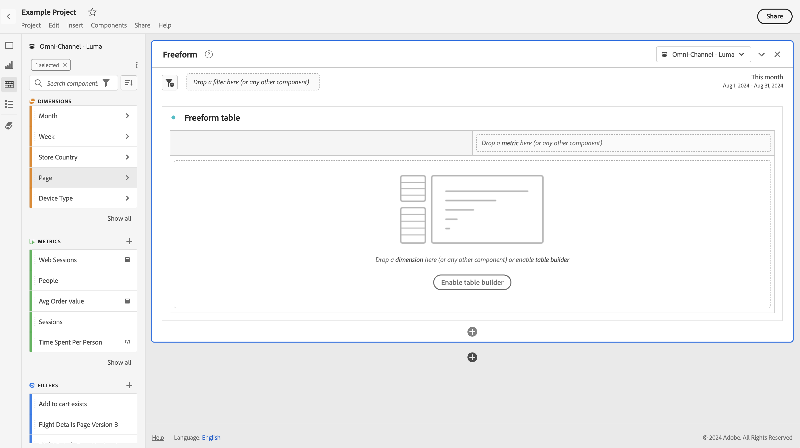
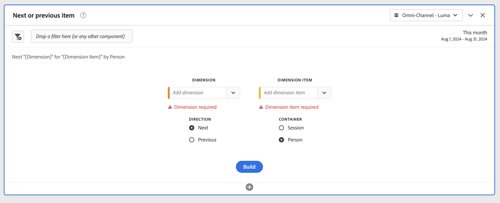

# Barrierefreiheit in Analysis Workspace

Erfahren Sie mehr über die Unterstützung der Barrierefreiheit in [!UICONTROL Analysis Workspace], dem führenden Analyse-Tool für Customer Journey Analytics.

Barrierefreiheit bezieht sich darauf, Produkte für Menschen mit visuellen, akustischen, kognitiven, motorischen und anderen Behinderungen nutzbar zu machen. Beispiele für Funktionen für die Barrierefreiheit für Software-Produkte:

* Bildschirmlesehilfen,
* Textäquivalente für Grafiken,
* Tastaturbefehle
* Änderung der Anzeigefarben auf hohen Kontrast,
* und vieles mehr.

[!UICONTROL Analysis Workspace] bietet einige Tools, um die Verwendung zu ermöglichen, darunter:

## Tastaturnavigation

Die Navigation in [!UICONTROL Analysis Workspace] funktioniert von oben nach unten und von links nach rechts. Die folgenden Navigationselemente erleichtern die Zugänglichkeit:

* Die **[!UICONTROL Tab]**-Taste ermöglicht Markierungskurzbefehle, mit denen Sie zwischen größeren Abschnitten in Workspace wechseln können. Im linken Panel können Sie mit der **[!UICONTROL Tab]**-Taste auch von einer ziehbaren Option zur nächsten wechseln.
* Mit ◀ und ▶ wechseln Sie zwischen einzelnen Elementen, nachdem Sie mit der **[!UICONTROL Tab]**-Taste ein Element hervorgehoben haben.
* Mit der Taste **[!UICONTROL F6]** navigieren Sie zum ersten Panel im Projekt und können zwischen den Visualisierungen in diesem Panel wechseln. Anschließend wird zum nächsten Panel im Projekt gewechselt und es wird wiederholt.
* Es werden Fokusindikatoren angewendet, sodass sehende Tastaturbenutzende einen klaren Hinweis darauf haben, welches Element der Benutzeroberfläche derzeit im Fokus ist. Der Indikator ist ein blauer Rahmen für das Panel, das den Fokus besitzt. Die kürzlich ausgewählte Funktion und die Auswahl innerhalb der Funktion hat einen grauen Hintergrund. In diesem Beispiel wurden kürzlich die [!UICONTROL Komponenten] und die Dimension „Seite“ ausgewählt.

  

### Tastaturnavigation zur Menüleiste

1. Drücken Sie die Tabulatortaste, bis Sie die Menüleiste erreicht haben.
1. Verwenden Sie die Pfeiltasten, um zwischen Menüs und Menüelementen zu navigieren.
1. Drücken Sie die **[!UICONTROL Eingabetaste]** , um ein Menü zu öffnen oder ein Menüelement auszuwählen.
1. Verwenden Sie **[!UICONTROL Esc]**, um ein Menü zu schließen.

### Tastaturnavigation für Drag-and-Drop-Interaktionen

[!UICONTROL Analysis Workspace] ist eine Drag-and-Drop-Benutzeroberfläche. Benutzende können jedoch stattdessen Komponenten über die Tastatur hinzufügen:

1. Navigieren Sie mit der Tab-Taste zu einer Komponente im linken Bedienfeld.
1. Drücken Sie zum Auswählen die **[!UICONTROL Eingabetaste]**.
1. Verwenden Sie die Pfeiltasten, um zu dem Bereich zu navigieren, in dem Sie die Komponente ablegen möchten.
1. Drücken Sie zum Platzieren der Komponente die **[!UICONTROL Eingabetaste]**.

### Tastaturnavigation für Tabellenspalten {#table-columns}

Sie können die Größe von Tabellenspalten über die Tastatur ändern und neu anordnen. Die gleichen Tasten funktionieren unter macOS und Windows.

#### Spaltengröße ändern {#resize-columns}

Sie können die Größe von Spalten in Freiformtabellen und Kohortentabellen mithilfe des Spaltentrennzeichens ändern, das die Grenze zwischen zwei Spaltenüberschriften darstellt.

1. Drücken Sie **[!UICONTROL Tabulatortaste]**, bis ein Spaltentrennzeichen den Fokus hat.

   Anweisungen zum Ändern der Anzeigegröße, während das Trennzeichen den Fokus hat. Die Sprachausgabe gibt diese Anweisungen und die aktuelle Breite der Spalte als Prozentsatz aus.

1. Verwenden Sie die folgenden Schlüssel, um die Größe der Spalte zu ändern. Die Größe einer Spalte kann nicht über ihre minimale oder maximale Breite hinaus geändert werden.

   | Schlüssel | Aktion |
   | --- | --- |
   | **[!UICONTROL Nach links]** | Schränken Sie die Spalte links neben dem Trennzeichen um 10 Pixel ein. |
   | **[!UICONTROL Nach-rechts-Taste]** | Die Spalte links neben dem Trennzeichen um 10 Pixel erweitern. |
   | **[!UICONTROL Eingeben]** | Spaltenbreite zurücksetzen. |

#### Spalten neu anordnen {#rearrange-columns}

In einer Freiformtabelle, die Sie bearbeiten können, können Sie eine Spalte mithilfe des Menüs **[!UICONTROL Neu anordnen]** in der Spaltenüberschrift nach links oder rechts verschieben.

1. Drücken Sie **[!UICONTROL Tabulatortaste]**, bis die Schaltfläche **[!UICONTROL Neu anordnen]** in der Spaltenüberschrift den Fokus hat.
1. Drücken Sie **[!UICONTROL Eingabetaste]**, **[!UICONTROL Leertaste]** oder **[!UICONTROL Abwärtspfeil]**, um das Menü zu öffnen.
1. Wählen Sie **[!UICONTROL Spalte nach links verschieben]** oder **[!UICONTROL Spalte nach rechts verschieben]** aus.

   Um das Menü zu schließen, ohne die Spalte zu verschieben, drücken Sie **[!UICONTROL Esc]**. Der Fokus kehrt zur Schaltfläche **[!UICONTROL Neu anordnen]** zurück.

   Nachdem Sie eine Spalte verschoben haben, gibt die Sprachausgabe den Spaltennamen und die neue Position innerhalb der Gruppe aus.

Beachten Sie beim Neuanordnen von Spalten mit der Tastatur Folgendes:

* Eine Spalte wird nur innerhalb ihrer Gruppe gleichrangiger Spalten verschoben, bei denen es sich um Spalten auf derselben Ebene unter derselben übergeordneten Kopfzeile handelt. Sie können die Tastatur nicht verwenden, um eine Spalte in eine andere Gruppe zu verschieben oder eine Spalte zu kopieren.
* Wenn Sie eine übergeordnete Kopfzeile verschieben, werden deren verschachtelte Spalten und Filter mit ihr verschoben.
* **[!UICONTROL Spalte nach links verschieben]** ist für die erste Spalte in einer Gruppe deaktiviert. **[!UICONTROL Spalte nach rechts verschieben]** ist für die letzte Spalte in einer Gruppe deaktiviert.
* Die **[!UICONTROL Neu anordnen]**-Schaltfläche ist nur für Spalten verfügbar, die Sie durch Ziehen auch neu anordnen können. Sie ist nicht verfügbar für:
  * Schreibgeschützte Tabellen oder Tabellen mit deaktivierter Interaktion.
  * Freiformtabellen mit [mehreren Dimensionsspalten](/help/analysis-workspace/visualizations/freeform-table/freeform-table-multidimensions.md) in die Sie keine Spalten ziehen können.
  * Datumsspalten in Kohortentabellen.

### Tastaturbefehle (Hotkeys)

[!UICONTROL Analysis Workspace] bietet eine umfangreiche Auswahl an [Tastaturbefehlen](/help/analysis-workspace/build-workspace-project/fa-shortcut-keys.md) für einen nahtloseren Workflow.

## Unterstützung für Bildschirmlesehilfen und Vergrößerungs-Software

Eine Bildschirmlesehilfe liest Text, der auf dem Computer-Bildschirm angezeigt wird. Es werden auch nicht textuelle Informationen wie Schaltflächenbeschriftungen oder Bildbeschreibungen in der Anwendung gelesen.

## Farbpaletten und Kontrast

[!UICONTROL Analysis Workspace] strebt die Konformität mit WCAG 2.1 AA an, einschließlich der Anforderungen an den Farbkontrast.

Darüber hinaus können Benutzer ihre eigene bevorzugte Farbpalette für ein Projekt unter **[!UICONTROL Projekt]** > **[!UICONTROL Projekteinstellungen]** > [Farbpalette](/help/analysis-workspace/build-workspace-project/color-palettes.md) festlegen.

## Erforderliche Validierung

Beim Erstellen einer Komponente, einer Visualisierung oder eines Panels werden die erforderlichen Felder beim Speichern validiert. Wenn ein erforderliches Feld die Validierung nicht erfolgreich durchläuft, wird es mit einer roten Umrandung und einem Fehlersymbol gekennzeichnet. Eine schriftliche Beschreibung erklärt den Handlungsbedarf.

## Unterstützung für Barrierefreiheitsfunktionen des Betriebssystems

Analysis Workspace unterstützt integrierte Windows- und macOS-Eingabehilfen wie den Modus für hohen Kontrast, Einrastfunktionen und Anschlaggeschwindigkeit/Anschlagverzögerung. Es werden auch Informationen über die Benutzeroberfläche des Betriebssystems bereitgestellt, um die Interaktion mit Hilfstechnologien zu ermöglichen, einschließlich Bildschirmlesehilfen wie VoiceOver für macOS und NVDA unter Windows.
