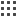
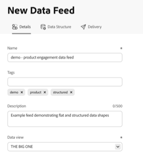

# Erstellen eines Daten-Feeds

{{release-limited-testing}}

Stellen Sie Adobe beim Erstellen eines Daten-Feeds Folgendes zur Verfügung:

* Informationen über das Ziel, an das Rohdatendateien gesendet werden sollen

* Die Daten, die in jede Datei aufgenommen werden sollen

* Die Häufigkeit, mit der Daten gesendet werden (einschließlich der Verarbeitungsverzögerung zur Erfassung verspäteter Ereignisse)

Bevor Sie einen Datenfeed erstellen, ist es wichtig, dass Sie die Grundlagen von Datenfeeds verstehen und sicherstellen, dass Sie alle Voraussetzungen erfüllen. Weitere Informationen finden Sie unter [Datenfeeds – Überblick](data-feed-overview.md).

## Erstellen und Konfigurieren eines Daten-Feeds {#create-and-configure-data-feed}

<!-- markdownlint-disable MD034 -->

>[!CONTEXTUALHELP]
>id="cja_datafeed_export_file"
>title="Manifest"
>abstract="Wählen Sie aus, ob bei jeder Daten-Feed-Bereitstellung eine Manifestdatei enthalten sein soll. Manifestdateien enthalten Informationen für jede im Daten-Feed enthaltene Datei. Beim Senden von Daten-Feed-Daten in einem einzelnen Paket können Sie auch eine Finish-Datei einschließen. Manifestdateien werden jedoch empfohlen. "

<!-- markdownlint-enable MD034 -->

<!-- markdownlint-disable MD034 -->

>[!CONTEXTUALHELP]
>id="cja_datafeed_notify"
>title="Benachrichtigen über Probleme bei Abschluss oder Ablauf"
>abstract="Geben Sie eine oder mehrere E-Mail-Adressen an, an die bei Abschluss oder Ablauf des Daten-Feeds bzw. bei Auftreten von Problemen eine Benachrichtigung gesendet werden soll. Trennen Sie mehrere E-Mail-Adressen durch ein Komma."

<!-- markdownlint-enable MD034 -->

<!-- markdownlint-disable MD034 -->

>[!CONTEXTUALHELP]
>id="cja_datafeed_frequency_granularity"
>title="Häufigkeit und Granularität"
>abstract="**Versandhäufigkeit** (Live-Feeds): Wie oft der Daten-Feed gesendet wird. Stündliche Sendungen enthalten die Daten einer Stunde; tägliche Sendungen enthalten die Daten eines Tages.
Jeder Versand blickt außerdem auf ein rollierendes 30-tägiges Verarbeitungsfenster zurück, um Segmente zu qualifizieren, Sitzungen zu berechnen und Dimensionswerte beizubehalten. Sowohl das Verarbeitungsfenster als auch die Verarbeitungsverzögerung können sich darauf auswirken, welche Ereignisse eingeschlossen werden.

**Granularität** (Aufstockungs-Feeds): Das Zeitintervall, das zum Aufteilen historischer Daten verwendet wird. Jeder Chunk enthält die Daten eines Tages und wird so schnell wie möglich gesendet, nicht einmal pro Tag. Dieses Feld ist immer auf „Täglich“ festgelegt und kann nicht geändert werden.
"

<!-- markdownlint-enable MD034 -->

1. Melden Sie sich mit Ihren Adobe ID-Anmeldeinformationen bei [experiencecloud.adobe.com](https://experiencecloud.adobe.com) an.

1. Wählen Sie [!UICONTROL **Customer Journey Analytics**] im App-Umschalter  oben rechts in der Benutzeroberfläche aus.

1. Navigieren Sie in der oberen Navigationsleiste zu [!UICONTROL **Komponenten**] > [!UICONTROL **Exporte**].

1. Wählen Sie die [!UICONTROL **Daten-Feeds**] aus.

1. Wählen [!UICONTROL **Erstellen**] in der oberen rechten Ecke des Bildschirms aus.

   Oder wählen Sie, wenn zuvor keine Daten-Feeds erstellt wurden [!UICONTROL **in**] leeren Tabelle die Option „Daten-Feed erstellen“ aus.

   Eine Seite wird mit den folgenden Registerkarten angezeigt: [!UICONTROL **Details**], [!UICONTROL **Datenstruktur**] und [!UICONTROL **Versand**].

   

1. Füllen Sie auf [!UICONTROL **Registerkarte**] Details“ die folgenden Felder aus:

   | Feld | Funktion |
   |---------|----------|
   | [!UICONTROL **Name**] | Der Name des Datenfeeds. Namen müssen in der ausgewählten Datenansicht eindeutig sein und können bis zu 255 Zeichen lang sein. <!--[Learn more](/help/export/analytics-data-feed/df-faq.md#must-feed-names-be-unique)--> |
   | [!UICONTROL **Tags**] | Wenden Sie beliebige Tags auf den Daten-Feed an, um die Kategorisierung zu erleichtern. <!--You can filter on tags as described in [Filter and search the list of data feeds](/help/export/analytics-data-feed/df-manage-feeds.md#filter-and-search-the-list-of-data-feeds) in [Manage data feeds](/help/export/analytics-data-feed/df-manage-feeds.md).--> |
   | [!UICONTROL **Beschreibung**] | Geben Sie eine Beschreibung für den Daten-Feed ein (bis zu 500 Zeichen). Die von Ihnen hinzugefügte Beschreibung ist beim Bearbeiten des Daten-Feeds sichtbar. |
   | [!UICONTROL **Datenansicht**] | Wählen Sie die Datenansicht aus, die die zu exportierenden Daten enthält.
Beachten Sie bei der Auswahl einer Datenansicht Folgendes:
 <ul><li>Wenn mehrere Daten-Feeds für dieselbe Datenansicht erstellt werden, muss jeder Daten-Feed unterschiedliche Spaltendefinitionen haben.</li><li>Die Liste der verfügbaren Spalten hängt vom Anmeldeunternehmen ab, zu dem die ausgewählte Datenansicht gehört. Wenn Sie die Datenansicht ändern, kann sich die Liste der verfügbaren Spalten ändern. </li></ul> |

1. Wählen Sie [!UICONTROL **Weiter**] aus.

1. Stellen [!UICONTROL **auf der Registerkarte**] Datenstruktur) sicher, dass im Feld **[!UICONTROL Datenansicht“ die richtige]** ausgewählt ist.

   <!--add screenshot-->

1. Suchen Sie [!UICONTROL **Dropdown-Menü**] Segmente“ nach beliebigen Segmenten und wählen Sie diese aus, um die in Ihrem Feed enthaltenen Daten zu filtern.

   Wenn Sie mehrere Segmente anwenden, werden sie mit einem AND-Operator verbunden. Um Segmente mit einem OR-Operator zu verbinden, müssen Sie zunächst ein neues Segment in Segment Builder erstellen und dann das neue Segment auf den Daten-Feed anwenden.

   Segmente, die Sie hier anwenden, kommen zu Segmenten hinzu, die möglicherweise bereits in Ihrer Datenansicht angewendet werden.

1. (Optional) Suchen Sie in der linken Leiste mithilfe des Felds **Suche** nach bestimmten Komponenten. Oder wählen Sie das Symbol **Sortieren** (Symbol , um eine der folgenden Sortieroptionen anzuwenden:

   | Option | Funktion |
   | --------- | ---------- |
   | [!UICONTROL **Empfohlen**] | Sortiert Komponenten so, dass empfohlene Komponenten am Anfang der Liste stehen. Komponenten, die am häufigsten und zuletzt von Ihnen oder anderen in Ihrem Unternehmen verwendet werden, werden weiter oben in der Liste angezeigt. |
   | [!UICONTROL **Alphabetisch**] | Sortiert Komponenten alphabetisch. |
   | [!UICONTROL **Kategorisch**] | Sortiert Komponenten ähnlich wie [!UICONTROL **Empfohlen**] mit dem Unterschied, dass Komponenten separat gruppiert werden, anstatt miteinander gemischt zu werden. |

1. Fügen Sie Komponenten zur Daten-Feed-Konfiguration hinzu. In der linken Leiste werden nur Komponenten angezeigt, die für Daten-Feeds gültig sind.

   * **Drag-and-Drop**: Ziehen Sie Komponenten aus der linken Leiste auf die Arbeitsfläche. Halten Sie **[!UICONTROL Umschalt]** oder halten Sie **[!UICONTROL Befehl]** (macOS) oder **[!UICONTROL Strg]** (Windows) gedrückt, um mehrere Komponenten gleichzeitig auszuwählen und zu ziehen.
   * **Plus-Schaltfläche**: Wählen Sie in der linken Leiste das Symbol Plus  neben einer beliebigen Komponente aus, um sie zur Arbeitsfläche hinzuzufügen.
   * **[!UICONTROL Alle anzeigen]**: Wählen Sie **[!UICONTROL Alle anzeigen]** unten in der Komponentenliste aus, um ein Dialogfeld mit allen verfügbaren Komponenten zu öffnen. Aktivieren Sie das Kontrollkästchen neben jeder Komponente, die Sie hinzufügen möchten, und klicken Sie dann auf **[!UICONTROL Auswahl hinzufügen]**. Wenn ein Suchbegriff oder Filter-Tag in der linken Leiste aktiv ist, wird auch eine **[!UICONTROL Alle hinzufügen]**-Schaltfläche angezeigt, über die Sie alle gefilterten Ergebnisse gleichzeitig hinzufügen können.

   Beachten Sie beim Hinzufügen von Feldern Folgendes:

   * Einige Komponenten sind erforderlich, werden nicht unterstützt oder weisen Einschränkungen in Daten-Feeds auf. Weitere Informationen finden Sie [Komponentenverfügbarkeit in Daten-Feeds](/help/components/exports/cja-data-feeds/df-components.md).

   * Wenn Sie eine Komponente hinzufügen, die zu einem XDM-Array-Feld (z. B. einem Adobe Journey Optimizer-Vorschlagsfeld) oder einem Zuordnungsfeld gehört, werden Sie in einem Dialogfeld aufgefordert, beliebige andere Komponenten aus demselben Unterereignis hinzuzufügen. In der Daten-Feed-Ausgabe werden alle diese Komponenten in einer Spalte angezeigt. Weitere Informationen finden Sie unter [Komponenten von Unterereignissen in Daten-Feeds](/help/components/exports/cja-data-feeds/df-sub-event.md)

1. (Optional) Ordnen Sie Komponenten auf der Arbeitsfläche neu an, indem Sie sie ziehen. Die von Ihnen definierte Reihenfolge wird als Spaltenreihenfolge in der exportierten Daten-Feed-Datei beibehalten.

1. (Optional) Ändern Sie die Spaltengröße auf der Arbeitsfläche, indem Sie den Spaltenrahmen ziehen.

   Spaltenbreiten werden in einem Cookie gespeichert und bleiben erhalten, wenn Sie das nächste Mal im selben Browser zu diesem Daten-Feed zurückkehren.

1. (Optional) Ändern der Ausgabe-ID einer Komponente. Die Ausgabe-ID ist der Spaltenname in der Daten-Feed-Ausgabe.

   Standardmäßig ist die Ausgabe-ID die Komponenten-ID im snake_case. Eine Änderung der Ausgabe-ID wirkt sich nur auf diesen Daten-Feed aus. Die Komponenten-ID in der Datenansicht wird nicht geändert. In der Schemavorschau ist der `id` die Ausgabe-ID.

   Ausgabe-IDs müssen:

   * Innerhalb des Daten-Feeds eindeutig sein.
   * Nur Buchstaben, Zahlen und Unterstriche (`_`) enthalten. Leerzeichen, Punkte (`.`), Bindestriche (`-`), Schrägstriche (`/`) und andere Sonderzeichen sind nicht zulässig.
   * Beginnen Sie mit einem Buchstaben oder einem Unterstrich.
   * 255 Zeichen oder weniger sein.

   Ausgabe-IDs können nicht mit `_cja` beginnen, das für die Verwendung in Adobe reserviert ist.

   Sie können Ausgabe-IDs einzeln oder stapelweise ändern:

   +++ So ändern Sie die Ausgabe-ID einer einzelnen Komponente

   1. Bewegen Sie den Mauszeiger über eine Komponente auf der Arbeitsfläche und klicken Sie dann auf das Informationssymbol .

   1. Klicken Sie auf das Bearbeitungssymbol  neben der ID und geben Sie dann eine neue Ausgabe-ID an.

      <!--add screenshot-->

   +++

   +++ So ändern Sie mehrere Ausgabe-IDs gleichzeitig

   1. Wählen Sie unter dem **[!UICONTROL Schemavorschau]** die Option **[!UICONTROL Massenbearbeitung von Ausgabe-IDs]** aus.

   1. Wählen Sie **[!UICONTROL Kopieren]** aus und fügen Sie dann die JSON-Datei in einen Texteditor oder ein anderes Tool ein.

   1. Aktualisieren Sie die `id`, d. h. die Ausgabe-IDs. Komponentennamen (`name`) oder -typen (`type` und `dataType`) können nicht geändert werden.

   1. Fügen Sie die bearbeitete JSON-Datei wieder in das Dialogfeld ein, ersetzen Sie die vorhandene JSON-Datei und wählen Sie dann **[!UICONTROL Validieren]** aus.

   1. Überprüfen Sie die Anzahl der geänderten IDs, der unveränderten IDs und der Fehler. Wenn Fehler auftreten, wählen Sie &quot;**[!UICONTROL &quot; aus]** um diese zu beheben.

   1. Wählen **[!UICONTROL Änderungen anwenden]** aus.

   <!--SME CHECK: How are JSON entries matched to components (order or name)? What happens if entries are reordered, removed, or added? Where are error details shown?-->

   +++

1. (Optional) Verwenden Sie die Bedienfelder **[!UICONTROL Feed]** Zusammenfassung und **[!UICONTROL Schemavorschau]** auf der rechten Seite der Seite, um Ihre Datenstruktur zu überprüfen, bevor Sie fortfahren:

   * Die **[!UICONTROL Feed-Zusammenfassung]** zeigt die Live-Anzahl aller hinzugefügten Komponenten, Spalten, Dimensionen und Metriken an.
   * Die **[!UICONTROL Schemavorschau]** zeigt eine JSON-Darstellung des Daten-Feed-Schemas, das beim Hinzufügen oder Neuanordnen von Komponenten aktualisiert wird.
   * Mit der Schaltfläche **[!UICONTROL Beispielzeilen]** wird ein Dialogfeld geöffnet, in dem Beispielausgabezeilen angezeigt werden, damit Sie überprüfen können, ob die Struktur korrekt aussieht. Dieses Dialogfeld zeigt nur Beispieldaten und spiegelt nicht Ihre tatsächlichen Daten wider.

   <!--add screenshot-->

1. Wählen Sie auf der [!UICONTROL **Versand**] im Abschnitt [!UICONTROL **Planung**] den Feed-Typ aus, den Sie erstellen möchten (Live oder Aufstockung), und geben Sie dann die Häufigkeit, die Verarbeitungsverzögerung und andere Konfigurationsoptionen an:

   <!--add screenshot-->

   | Feld | Funktion |
   |---------|----------|
   | [!UICONTROL **Feed-Typ**] | Wählen Sie den Feed-Typ aus, den Sie erstellen möchten:<ul><li>[!UICONTROL **Live-Feed**]: Exportiert aktuelle und zukünftige Daten.</li><li>[!UICONTROL **Aufstockungsfeed**]: Exportiert historische Daten. </li></ul> |
   | [!UICONTROL **Startdatum**] | Das Datum, an dem der Daten-Feed beginnt. Bei Live-Feeds muss dies heute oder ein Datum in der Zukunft sein. Bei Aufstockungs-Feeds muss es sich um ein vergangenes Datum im Datenaufbewahrungsfenster der Datenansicht handeln. Das Startdatum basiert auf der Zeitzone der Datenansicht. |
   | [!UICONTROL **Ablaufdatum**]  Nur für Live-Feeds verfügbar | Das Datum, an dem der Daten-Feed abläuft und nicht mehr ausgeführt wird. Das Datum basiert auf der Zeitzone der Datenansicht. |
   | [!UICONTROL **Enddatum**]  Nur für Aufstockungs-Feeds verfügbar | Das Datum, an dem der Daten-Feed endet. Das Enddatum darf nicht in der Zukunft liegen. Das Datum basiert auf der Zeitzone der Datenansicht. |
   | [!UICONTROL **Häufigkeit**]  Nur für Live-Feeds verfügbar | Legen Sie fest, wie oft der Daten-Feed gesendet werden soll. Ereignisse mit Zeitstempeln, die in das Häufigkeitsfenster fallen, werden in den Daten-Feed-Versand aufgenommen. 
Wählen Sie diese Option aus, um Daten aus einer Stunde oder aus Daten aus einem Tag aufzunehmen.
<ul><li>**Täglich**: Feeds enthalten Daten eines ganzen Tages von Mitternacht bis Mitternacht in der Zeitzone der Datenansicht.</li><li>**Stündlich**: Feeds enthalten Daten für eine einzige Stunde.</li></ul> 
Jeder Versand verwendet außerdem ein rollierendes 30-tägiges Verarbeitungsfenster, das zum Häufigkeitsfenster führt und dieses einschließt, um Segmente zu qualifizieren, Sitzungen zu berechnen und Dimensionswerte beizubehalten. Sowohl das Verarbeitungsfenster als auch die Einstellung [!UICONTROL **Verarbeitungsverzögerung**] können sich darauf auswirken, welche Ereignisse eingeschlossen werden. Weitere Informationen finden Sie unter [Grundlegendes zum Verarbeitungsfenster](#data-feed-processing-window) und [Grundlegendes zur Verarbeitungsverzögerung](#data-feed-processing-delay).
 |
   | [!UICONTROL **Granularität**]  Nur für Aufstockungs-Feeds verfügbar | Das Zeitintervall, das zum Aufteilen historischer Daten in Blöcke verwendet wird. Jeder Chunk enthält Daten eines ganzen Tages von Mitternacht bis Mitternacht in der Zeitzone der Datenansicht. 
Die Granularität bestimmt, wie die Daten gruppiert werden, und nicht, wie oft sie bereitgestellt werden. Aufstockungsdaten werden so schnell wie möglich bereitgestellt, nicht einmal pro Tag.

Dieses Feld ist immer auf &quot;[!UICONTROL **&quot; festgelegt**] kann nicht geändert werden.
 |
   | [!UICONTROL **Verarbeitungsverzögerung**] | Die Zeitspanne, die Customer Journey Analytics vor dem Verarbeiten einer Daten-Feed-Datei wartet. Alle verspätet eintreffenden Ereignisse, die während der Verarbeitungsverzögerung eingehen, werden im Daten-Feed berücksichtigt. 
Wählen Sie eine Verzögerung aus, die lang genug ist, damit die langsamsten Daten in Ihrer Verbindung die Verarbeitung abschließen. Wenn die Verzögerung zu kurz ist, werden Daten, die noch verarbeitet werden, nicht in die Daten-Feed-Datei einbezogen.

Die minimale Verarbeitungsverzögerung beträgt 2 Stunden. Die Standardeinstellung basiert auf den Datensätzen in Ihrer Verbindung. Wenn das Zusammenfügen beispielsweise aktiviert ist, ist der Standardwert 6 Stunden. Einige Datentypen erfordern eine längere Verzögerung. Die ausgewählte Verzögerung hängt von den Datentypen in Ihrer Verbindung ab, z. B. Streaming-, Batch-, zugeordnete, Lookup- oder Profildaten.

Bevor Sie diese Option konfigurieren, lesen Sie die Details und Beispiele im folgenden Abschnitt [Grundlegendes zur Verarbeitungsverzögerung](#data-feed-processing-delay).
 |
   | [!UICONTROL **Komprimierungsformat**] | Wählen Sie das Komprimierungsformat für die Parquet-Ausgabedateien aus, die an Ihr Cloud-Ziel gesendet werden. Wählen Sie aus den folgenden Formaten:<ul><li>[!UICONTROL **Snappy**]: Schnelle Komprimierung und Dekomprimierung bei moderaten Dateigrößen. Wird von modernen Datenplattformen wie BigQuery, Snowflake und Apache Spark weithin unterstützt.</li><li>[!UICONTROL **GZip**]: Grob kompatibel, auch mit Tools, die Snappy nicht nativ unterstützen. Empfohlen, wenn Ihre nachgelagerte Pipeline einen weithin anerkannten Komprimierungsstandard erfordert.</li><li>[!UICONTROL **Z Standard (Zstd)**]: Hohe Komprimierungseffizienz mit schneller Dekomprimierung. Geeignet, wenn die Minimierung der Dateigröße eine Priorität ist und Ihre Tools Zstd unterstützen.</li></ul>
Alle Formate komprimieren Daten in jeder Parquet-Datei spaltenweise, sodass Ihr Data Warehouse weiterhin nur die Spalten lesen kann, die eine Abfrage benötigt.

Informationen zu den Vorteilen von Parquet und zum Abfragen oder Laden der Dateien nach der Bereitstellung finden Sie unter [Arbeiten mit Parquet-Dateien in Daten-Feeds](/help/components/exports/cja-data-feeds/df-parquet.md).
 |

1. Konfigurieren Sie auf [!UICONTROL **Registerkarte**] im Abschnitt [!UICONTROL **Ziel**] das Ziel, an das die Daten gesendet werden sollen.

   >[!NOTE]
   >
   >Beachten Sie bei der Konfiguration eines Berichtsziels Folgendes:
   >
   ><!--* Adobe recommends using a cloud account for your report destination. [Legacy FTP and SFTP accounts](/help/components/locations/configure-import-accounts.md) are available, but are not recommended.-->
   >* Alle zuvor konfigurierten Cloud-Konten stehen für Daten-Feeds zur Verfügung. Sie können Cloud-Konten über den Standort-Manager unter [Komponenten > Exporte > Speicherort-Konten](/help/components/exports/cloud-export-accounts.md) konfigurieren.
   >
   >* Cloud-Konten sind mit Ihrem Customer Journey Analytics-Benutzerkonto verknüpft. Andere Benutzer können von Ihnen konfigurierte Cloud-Konten nur verwenden oder anzeigen, wenn Sie sie für alle Benutzer in Ihrer Organisation verfügbar machen.
   >
   >* Sie können alle Speicherorte bearbeiten, die Sie über den Standort-Manager unter [Komponenten > Exporte > Speicherorte](/help/components/exports/cloud-export-locations.md) erstellen.

   Füllen Sie die folgenden Felder aus:

   | Feld | Funktion |
   |---------|----------|
   | [!UICONTROL **Anzeigen von Zielen für alle Benutzer**] | Wenn Sie Systemadministrator sind, können Sie diese Option aktivieren, um Ziele anzuzeigen, die von allen Benutzern in Ihrer Organisation erstellt wurden. Wenn diese Option deaktiviert ist, werden nur von Ihnen erstellte Ziele angezeigt. |
   | [!UICONTROL **Konto**] | Führen Sie einen der folgenden Schritte aus:<ul><li>**Vorhandenes Konto verwenden:** Wählen Sie das Dropdown-Menü neben dem Feld **[!UICONTROL Konto]** aus. Oder geben Sie den Kontonamen ein und wählen Sie ihn dann aus dem Dropdown-Menü aus. 
Konten stehen Ihnen nur zur Verfügung, wenn Sie sie konfiguriert haben oder wenn sie für eine Organisation freigegeben wurden, der Sie angehören.
</li><li>**Neues Konto erstellen:** Wählen Sie **[!UICONTROL Konto hinzufügen]** im **[!UICONTROL Konto]** Dropdown-Menü aus. Informationen zum Konfigurieren des Kontos finden Sie unter [Konfigurieren von Cloud-Exportkonten](/help/components/exports/cloud-export-accounts.md).</li></ul> |
   | [!UICONTROL **Ort**] | Führen Sie einen der folgenden Schritte aus:<ul><li>**Vorhandenen Speicherort verwenden:** Wählen Sie das Dropdown-Menü neben dem Feld **[!UICONTROL Speicherort]** aus. Oder geben Sie den Ortsnamen ein und wählen Sie ihn dann aus dem Dropdown-Menü aus.</li><li>**Neuen Speicherort erstellen:** Wählen Sie **[!UICONTROL Speicherort hinzufügen]** im **[!UICONTROL Speicherort]** Dropdown-Menü aus. Informationen zum Konfigurieren des Speicherorts finden Sie unter [Konfigurieren von Cloud-Exportspeicherorten](/help/components/exports/cloud-export-locations.md).</li></ul> |
   | [!UICONTROL **Überschreiben des Standardpfads oder Dateinamens**] | Aktivieren Sie diese Option, um den Standardpfad oder Dateinamen zu überschreiben, der für den ausgewählten Speicherort festgelegt ist. Die Überschreibung gilt nur für diesen Daten-Feed und bestimmt, wohin Daten-Feed-Dateien gesendet werden.
Wenn diese Option aktiviert ist, wird das [!UICONTROL **Pfad oder Dateiname**] angezeigt.
 |
   | [!UICONTROL **Pfad oder Dateiname**]  Nur verfügbar, wenn [!UICONTROL **Standardpfad oder Dateiname überschreiben**] aktiviert ist | Geben Sie einen Pfad oder einen Dateinamen (oder beides) an, um zu bestimmen, wohin Dateien am ausgewählten Speicherort gesendet werden sollen. Um Dateien im Ordner der obersten Ebene des Speicherorts zu speichern, geben Sie `/` an.
Bei Live-Feeds können Sie eine der folgenden Variablen verwenden, um den Pfad oder Dateinamen dynamisch zu machen:
<ul><li>**{yyyy}**: 4-stelliges Kalenderjahr (von Schreibweise abhängig)</li><li>**{yy}**: 2-stelliges Kalenderjahr (von Schreibweise abhängig)</li><li>**{MM}**: 2-stelliger Monat (von Schreibweise abhängig)</li><li>**{dd}**: 2-stelliger Tag (von Schreibweise abhängig)</li><li>**{HH}**: 2-stellige Stunde (Groß-/Kleinschreibung beachten)</li><li>**{mm}**: 2-stellige Minuten (von Schreibweise abhängig)</li><li>**{ss}**: 2-stellige Sekunden (von Schreibweise abhängig)</li><li>**{fff}**: 3-stellige Nanosekunden (Groß-/Kleinschreibung beachten)</li><li>**{instance_id}**: Anfrage (Instanz)-UUID</li><li>**{export_id}**: Export (Zeitplan) UUID</li><li>**{idx}**: Index beginnt bei 0 (für jede Datei inkrementiert)</li><li>**{total}**: Gesamtzahl der Dateien für den gesamten Übertragungsauftrag</li><li>**{completion_millis}**: Übertragungszeit in Millisekunden</li></ul>
Wenn Sie beispielsweise `${yyyy}/${MM}/${dd}/my-feed-${instance_id}-${idx}` angeben, hätte ein Live-Feed, der am 15. Januar 2027 bereitgestellt wird, den folgenden Dateipfad und -namen: `[prefix_folder_name]/2027/01/15/my-feed-[UUID]-1.parquet`
 |
   | [!UICONTROL **Benachrichtigen Sie über Probleme, wenn sie abgeschlossen sind und ablaufen**] | Geben Sie eine oder mehrere E-Mail-Adressen an, an die bei Abschluss oder Ablauf des Daten-Feeds bzw. bei Auftreten von Problemen eine Benachrichtigung gesendet werden soll. Trennen Sie mehrere E-Mail-Adressen durch ein Komma. |
   | [!UICONTROL **Manifest aktivieren**] | Wählen Sie aus, ob bei jeder Daten-Feed-Bereitstellung eine Manifestdatei enthalten sein soll. Die Manifestdatei enthält Informationen für jede Datei, die im Daten-Feed enthalten ist. |

1. Wählen Sie **[!UICONTROL Speichern]** aus.

## Erläuterung des Verarbeitungsfensters {#data-feed-processing-window}

Das **Verarbeitungsfenster** ist ein rollierender Zeitraum von 30 Tagen, der zum ausgewählten Häufigkeitsfenster (Stunde oder Tag) führt und dieses einschließt. Customer Journey Analytics verwendet die Daten im Verarbeitungsfenster, um jeden Daten-Feed-Versand zu verarbeiten. Das Verarbeitungsfenster beträgt immer 30 Tage und kann nicht geändert werden.

Das Häufigkeitsfenster bestimmt, welche Ereignisse im Versand enthalten sind. Das Verarbeitungsfenster liefert den historischen Kontext, der erforderlich ist, um diese Ereignisse korrekt zu klassifizieren, z. B. welche Segmente sie für sich qualifizieren, zu welcher Sitzung sie gehören und welche Dimensionswerte für sie bestehen bleiben.

Das Verarbeitungsfenster funktioniert zusammen mit dem Häufigkeitsfenster ähnlich wie das Analysis Workspace-Berichtsfenster. Es gibt jedoch [wesentliche Unterschiede](/help/components/exports/cja-data-feeds/df-comparison-workspace.md#processing-window). Diese Unterschiede können zu Datendiskrepanzen zwischen Workspace-Berichten und Daten-Feed-Sendungen führen.

Segmentqualifikation, Sitzungsberechnung, Dimensionspersistenz und abgeleitete Feldtransformationen werden jeweils bei der Verarbeitung von Daten im Verarbeitungsfenster berücksichtigt:

### Segmentqualifikation

Wenn ein Segment auf Ihre Daten-Feed-Definition angewendet wird, bestimmen Daten innerhalb des Verarbeitungsfensters, welche Ereignisse, Sitzungen oder Personen für das Segment qualifiziert sind. Die Container-Einstellung des Segments bestimmt den Umfang. (Mögliche Container sind: Person, Sitzung oder Ereignis. B2B umfasst die folgenden zusätzlichen Container: Globales Konto, Konto, Opportunity, Einkaufsgruppe.)

>[!BEGINSHADEBOX]

**Beispiel:**

Angenommen, Sie möchten einen Daten-Feed erstellen, um das Verhalten von Benutzern zu verstehen, die Teil einer bestimmten Marketing-Kampagne sind, nämlich Campaign B.

Zu diesem Zweck wenden Sie ein Segment mit dem Namen _Benutzer in Campaign B_ auf den Daten-Feed an und geben an, dass nur die Ereignisse, die mit Benutzern in diesem Segment verknüpft sind, in den Daten-Feed aufgenommen werden sollen.

In diesem Fall werden Benutzer nur dann in den Daten-Feed aufgenommen, wenn sie **beide** der folgenden Bedingungen erfüllen:

* Der Benutzer hatte ein Ereignis mit einem Zeitstempel, das sich im Datenfeed-Häufigkeitsfenster befindet (die angegebene Stunde oder der angegebene Tag des Daten-Feeds).
* Der Benutzer hat sich für das Segment _Campaign B_ **irgendwann im Verarbeitungsfenster)**.

  Beispielsweise ist ein Benutzer, der sich vor 9 Tagen für das Segment qualifiziert hat **im Daten** Feed enthalten. Ein Benutzer, der sich zuletzt vor 45 Tagen qualifiziert hat **ist nicht**, da dieses Ereignis außerhalb des 30-tägigen Verarbeitungsfensters liegt.

>[!ENDSHADEBOX]

### Sitzungsberechnung

Sitzungsgrenzen werden anhand aller Ereignisse im Verarbeitungsfenster berechnet, nicht nur anhand der Ereignisse im Häufigkeitsfenster. Eine Sitzung, die vor dem Frequenzfenster gestartet wurde, wird weiterhin als dieselbe Sitzung erkannt.

Die Sitzungs-ID basiert auf der Person, der Sitzungsstartzeit und den Sitzungseinstellungen in Ihrer Datenansicht. Eine Sitzung behält die gleiche Sitzungs-ID für alle Sendungen bei, sodass Sie Ereignisse aus einer Sitzung verbinden können, die mehrere stündliche oder tägliche Sendungen umfasst.

Beachten Sie beim Arbeiten mit Sitzungen in Daten-Feeds Folgendes:

* Wenn eine Sitzung vor dem Verarbeitungsfenster gestartet wurde, sind ihre früheren Ereignisse nicht verfügbar, sodass die Sitzungswerte von Analysis Workspace abweichen können. Weitere Informationen finden Sie unter [Grundlegendes zu Datendiskrepanzen zwischen Daten-Feeds und Analysis Workspace](/help/components/exports/cja-data-feeds/df-comparison-workspace.md).
* Durch Ändern der Sitzungseinstellungen in der Datenansicht werden Sitzungs-IDs geändert. Die Sitzungs-IDs in späteren Sendungen stimmen nicht mit den Sitzungs-IDs in früheren Sendungen überein.

### Dimension-Persistenz

Wenn Sie die Persistenz für eine Dimension festlegen, legen Sie auch eine Gültigkeit fest, die bestimmt, wie lange das Dimensionselement über das Ereignis hinaus bestehen bleibt, für das es festgelegt ist.

Das Verarbeitungsfenster begrenzt die Persistenz für jede Ablaufeinstellung. Werte, die vor dem Verarbeitungsfenster festgelegt wurden, werden nicht berücksichtigt, es sei denn, sie haben [!UICONTROL **benutzerdefinierte Zeit**] Gültigkeit:

* [!UICONTROL **Sitzung**]: Die Werte bleiben bis zum Ende der Sitzung bestehen. Wenn eine Sitzung vor dem Verarbeitungsfenster gestartet wurde, werden vor dem Verarbeitungsfenster festgelegte Werte nicht berücksichtigt.
* [!UICONTROL **Fenster „Personen-Reporting**]: Das 30-tägige Verarbeitungsfenster wird als Ablauf verwendet. Nur Werte, die innerhalb des Verarbeitungsfensters festgelegt wurden, bleiben erhalten.
* [!UICONTROL **Benutzerdefinierte Zeit**]: Die Werte bleiben für die benutzerdefinierte Zeit bestehen, die für die Dimension festgelegt wurde. Wenn die benutzerdefinierte Zeit länger als das 30-tägige Verarbeitungsfenster ist, schaut der Daten-Feed vor dem Start des Verarbeitungsfensters zurück (bis zu 90 Tage), sodass Dimensionswerte, die vor dem Verarbeitungsfenster festgelegt wurden, auf Ereignisse im Versand beibehalten werden können.

  <!--FOLLOW-UP: Remove this note when the persistence back-end change (AN-495620) ships. Also remove the matching sentence in df-comparison-workspace.md (Dimension persistence bullet).-->

  >[!NOTE]
  >
  >Derzeit sind benutzerdefinierte Zeitabläufe auf das 30-tägige Verarbeitungsfenster beschränkt. Wenn die benutzerdefinierte Zeit länger als 30 Tage ist, wird stattdessen das Verarbeitungsfenster als Ablauf verwendet, und die vor dem Verarbeitungsfenster festgelegten Werte werden nicht berücksichtigt. Die Unterstützung benutzerdefinierter Zeiten, die über das Verarbeitungsfenster hinausgehen, wird bald verfügbar sein.

* [!UICONTROL **Metrik**]: Die Werte bleiben so lange bestehen, bis die ausgewählte Metrik auftritt. Werte, die vor dem Verarbeitungsfenster festgelegt wurden, werden nicht berücksichtigt.

Weitere Informationen zum Festlegen der Persistenz für Dimensionen in der Datenansicht finden Sie unter [Persistenzkomponenteneinstellungen](/help/data-views/component-settings/persistence.md). Weitere Informationen darüber, wie sich die Persistenz in Daten-Feeds von Analysis Workspace unterscheidet, finden [&#x200B; unter „Grundlegendes zu Datendiskrepanzen zwischen Daten-Feeds und Analysis Workspace](/help/components/exports/cja-data-feeds/df-comparison-workspace.md#processing-window).

>[!BEGINSHADEBOX]

**Beispiel:**

Angenommen, Sie möchten in Ihrem Daten-Feed wissen, welche Marketing-Kampagnen-Benutzer ursprünglich gesehen haben, bevor sie zu Ihrer Site kamen.

Zu diesem Zweck legen Sie die Persistenz für die Dimension Kampagnen mit Original als Zuordnungsmodell und [!UICONTROL **Fenster für Personenberichte**] als Gültigkeit fest.

In diesem Fall wird die ursprüngliche Kampagne nur dann in der Daten-Feed-Ausgabe angezeigt, wenn Benutzende **beide** der folgenden Bedingungen erfüllen:

* Der Benutzer hatte ein Ereignis mit einem Zeitstempel, das sich im Datenfeed-Häufigkeitsfenster befindet (die angegebene Stunde oder der angegebene Tag des Daten-Feeds).

* Der Benutzer hat sich für die ursprüngliche Kampagne qualifiziert **irgendwann im Verarbeitungsfenster**.

  Wenn sich der Benutzer vor 9 Tagen für die ursprüngliche Kampagne qualifiziert hat, **die ursprüngliche Kampagne (**) im Daten-Feed enthalten. Wenn sich der Benutzer vor 45 Tagen qualifiziert hat, **die ursprüngliche Kampagne nicht enthalten** da sie außerhalb des 30-tägigen Verarbeitungsfensters liegt.

>[!ENDSHADEBOX]

### Abgeleitete Feldtransformationen

Alle abgeleiteten Feldfunktionen, die auf Container verweisen, verwenden das Verarbeitungsfenster in Daten-Feed-Exporten. Welche Datumsfunktionen sind in abgeleiteten Feldern vorhanden? <!--Not sure how this applies.-->

## Informationen zur Verarbeitungsverzögerung {#data-feed-processing-delay}

<!-- markdownlint-disable MD034 -->

>[!CONTEXTUALHELP]
>id="cja_datafeed_processing_delay"
>title="Verarbeitungsverzögerung"
>abstract="Die Zeit, die das System wartet, bevor es eine Daten-Feed-Datei verarbeitet. Alle verspäteten Ereignisse, die während der Verzögerung eintreten, sind im Feed enthalten.
Die minimale Verarbeitungsverzögerung beträgt 2 Stunden, einige Datentypen erfordern jedoch mehr Zeit. Wählen Sie eine Verzögerung aus, die für die langsamsten Daten in Ihrer Verbindung lang genug ist. Wenn die Verarbeitungsverzögerung zu kurz ist, werden einige Daten möglicherweise nicht in den Feed eingeschlossen.
"

<!-- markdownlint-enable MD034 -->

### Funktionsweise der Verarbeitungsverzögerung

Die Verarbeitungsverzögerung ist die Zeit, die Customer Journey Analytics wartet, bevor eine Daten-Feed-Datei verarbeitet wird. Alle verspätet eintreffenden Ereignisse, die während der Verarbeitungsverzögerung eingehen, werden im Daten-Feed berücksichtigt.

Verarbeitungsverzögerungen sind aus verschiedenen Gründen erforderlich, z. B. um die Pipeline-Latenz zu berücksichtigen, um mobilen Implementierungen die Möglichkeit zu geben, dass Offline-Geräte online gehen und Daten senden, oder um die Server-seitigen Prozesse Ihres Unternehmens bei der Verwaltung zuvor verarbeiteter Dateien zu berücksichtigen.

Die Mindestdauer für die Verarbeitungsverzögerung beträgt 2 Stunden, für einige Arten von Daten ist jedoch eine längere Verzögerung erforderlich.

>[!BEGINSHADEBOX]

**Beispiel:**

Angenommen, ein stündlicher Daten-Feed umfasst Daten von 13:00 bis 14:00 Uhr und die Verarbeitungsverzögerung beträgt 2 Stunden. Die Verarbeitung für diese Daten-Feed-Datei beginnt um 16:00 Uhr und umfasst alle Daten, die vor Beginn der Verarbeitung eingegangen sind.

>[!ENDSHADEBOX]

### Auf Ihren Daten basierende Verarbeitungsverzögerung auswählen

Verschiedene Datentypen benötigen unterschiedlich viel Zeit, bis sie in Customer Journey Analytics verfügbar sind. Die Daten durchlaufen zwei Verarbeitungsphasen, wobei die Zeit für jede Phase addiert wird.

Wählen Sie eine Verarbeitungsverzögerung aus, die lang genug ist, damit die langsamsten Daten in Ihrer Verbindung beide Phasen abschließen. Wenn die Verzögerung zu kurz ist, werden Daten, die noch verarbeitet werden, nicht in die Daten-Feed-Datei einbezogen.

Wenn Sie einen Daten-Feed erstellen, wird die Verarbeitungsverzögerung standardmäßig auf einen empfohlenen Wert basierend auf den Datensätzen in Ihrer Verbindung zurückgesetzt. Wenn beispielsweise das Zusammenfügen für die Verbindung aktiviert ist, ist der Standardwert 6 Stunden. Sie können eine kürzere Verzögerung bis zum 2-Stunden-Minimum auswählen, es wird jedoch eine Warnung angezeigt, da einige Daten möglicherweise nicht im Daten-Feed enthalten sind.

#### Phase 1: Daten gelangen in den Data Lake von Experience Platform

Die Ankunftszeiten variieren je nach Art der Daten, die Sie erfassen. Wählen Sie eine Verzögerung aus, die dem erfassten Datentyp entspricht.

* **Ereignisdatensätze aus der Edge Network- oder Streaming-Aufnahme**: Normalerweise gelangen Daten innerhalb von 60 Minuten im Data Lake an (siehe [Latenzen](/help/technotes/guardrails.md#latencies)).

* **Analytics-Quell-Connector** Datensätze: Daten gelangen normalerweise innerhalb von 2,25 Stunden in den Data Lake (siehe [Latenzen](/help/technotes/guardrails.md#latencies)).

  <!--Default delay for Analytics source connector datasets is TBD (Oct 19 decision); add when confirmed.-->

* **Datensätze aus anderen Quell-Connectoren**: Die Latenz variiert je nach Quell-Connector und nach dem Zeitpunkt des Batch-Versands. Die Upstream-Verarbeitung in Experience Platform, z. B. die Datenvorbereitung, kann mehr Zeit hinzufügen.

* **Lookup-Datensätze**: Die Zeit, während der Daten im Data Lake eintreffen, hängt davon ab, wie oft Daten hochgeladen werden. Suchdaten werden in der Regel als vollständige Kopie einer Datenbank hochgeladen, in der sich nur ein kleiner Prozentsatz der Datensätze geändert hat. Laden Sie Suchdaten in kleineren Batches hoch, um die Verarbeitungszeit zu verkürzen.

  Kleine Uploads werden in der Regel innerhalb der minimalen Verzögerung verarbeitet.

  Große Uploads (z. B. ein wöchentlicher Upload von Millionen von Datensätzen) werden mit einer niedrigeren Priorität verarbeitet und können 3 bis 4 Stunden länger dauern. Bei großen Uploads werden die Ereignisdaten nicht verzögert, aber die Suchwerte spiegeln möglicherweise nicht die neuesten Aktualisierungen wider.

* **Profildatensätze**: Die Zeit, während der Daten im Data Lake eintreffen, hängt davon ab, wie oft Daten hochgeladen werden. Profildaten werden in der Regel in großen Batches aufgenommen, z. B. als tägliche Momentaufnahme der vollständigen Profiltabelle. Hochladen von Profildaten in kleineren Batches, um die Verarbeitungszeit zu verkürzen.

  Kleine Uploads werden in der Regel innerhalb der minimalen Verzögerung verarbeitet.

  Große Uploads (z. B. ein wöchentlicher Upload von Millionen von Datensätzen) werden mit einer niedrigeren Priorität verarbeitet und können 3 bis 4 Stunden länger dauern. Bei großen Uploads werden die Ereignisdaten nicht verzögert, aber die Profilwerte spiegeln möglicherweise nicht die neuesten Aktualisierungen wider.

#### Phase 2: Daten werden aus dem Data Lake in Customer Journey Analytics aufgenommen

Die Datenaufnahmezeiten variieren je nachdem, ob für den Datensatz die Zuordnung aktiviert ist.

* **Nicht zugeordnete Datensätze**: Dies kann bis zu 90 Minuten dauern (siehe [Latenzen](/help/technotes/guardrails.md#latencies)).

* **Zusammengefügte Datensätze**: Beim Zusammenfügen können zusätzlich zu den 90 Minuten, die für nicht zusammengefügte Datensätze erforderlich sind, bis zu 4 Stunden hinzugefügt werden (siehe [Latenzen](/help/technotes/guardrails.md#latencies)). Wenn das Zusammenfügen für die Verbindung aktiviert ist, beträgt die Standardverzögerung 6 Stunden. Daten, die durch eine Zusammenfügungs-Wiederholung aktualisiert werden, sind im Allgemeinen nicht in den Daten-Feed-Dateien enthalten, die bereits verarbeitet wurden.

>[!BEGINSHADEBOX]

**Beispiel:**

Wenn Ihre Verbindung mehrere Datentypen enthält, wählen Sie eine Verzögerung aus, die den langsamsten Daten entspricht. Im folgenden Beispiel sind dies etwa 8 Stunden.

Beim Zusammenfügen können bis zu 4 Stunden für die Aufnahme in Customer Journey Analytics hinzugefügt werden. Um dies zu berücksichtigen, fügen Sie für alle zugeordneten Daten 4 Stunden zur Verzögerung hinzu.

| Datenquelle | Phase 1: Ankunft im Data Lake | Phase 2: Aufnahme in Customer Journey Analytics | Gesamt |
| --- | --- | --- | --- |
| Edge Network- oder Streaming-Aufnahme | 60 Minuten | 90 Minuten 
ohne Stitching
 | 2,5 Stunden |
| Analytics-Quell-Connector | 2,25 Stunden | 90 Minuten + 4 Stunden zum Zusammennähen 
mit Stitching
 | 7,75 Stunden |

>[!ENDSHADEBOX]

