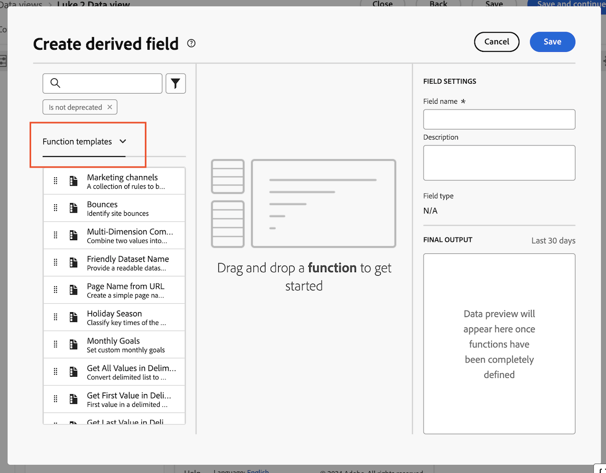

# Erstellen eines abgeleiteten Marketing-Kanal-Felds für Customer Journey Analytics {#create-marketing-channel-derived-field}

<!-- markdownlint-disable MD034 -->

>[!CONTEXTUALHELP]
>id="cja-upgrade-marketing-channel"
>title="Erstellen eines abgeleiteten Marketing-Kanal-Felds"
>abstract="Abgeleitete Felder werden in einer Datenansicht erstellt.  Die Verwendung einer standardmäßigen Marketing-Kanaleinrichtung dauert nur einige Minuten. Das Erstellen einer hochgradig benutzerdefinierten Marketing-Kanaleinrichtung kann mehrere Stunden dauern."

<!-- markdownlint-enable MD034 -->

{{upgrade-note-step}}

Bei Verwendung des Analytics-Quell-Connectors fließen Marketing-Kanal-Daten über diesen Connector in Customer Journey Analytics. Marketing-Kanal-Regeln werden im herkömmlichen Adobe Analytics konfiguriert, und einige Regeln werden nicht unterstützt. Weitere Informationen finden Sie unter [Verwenden von Marketing-Kanal-Dimensionen](/help/use-cases/aa-data/marketing-channels.md).

Um Marketing-Kanäle in Customer Journey Analytics mit der Experience Platform Web SDK zu verwenden, verwenden Sie abgeleitete Felder in einer Datenansicht, um dieselben Marketing-Kanäle und Verarbeitungsregeln neu zu erstellen.
1. Wählen Sie in Customer Journey Analytics die Datenansicht aus, der Sie Marketing-Kanäle hinzufügen möchten.

1. Wählen Sie in der Datenansicht die Registerkarte **[!UICONTROL Komponenten]** aus.

1. Wählen Sie in der linken Leiste **[!UICONTROL Abgeleitetes Feld erstellen]** aus.

1. Wählen Sie im Dialogfeld **[!UICONTROL Abgeleitetes Feld erstellen]** im Dropdown-Menü **[!UICONTROL Funktionsvorlagen]** aus.

   

1. Ziehen Sie die Vorlage **[!UICONTROL Marketing-Kanäle]** auf die leere Arbeitsfläche.

1. Die Logik für jeden Marketing-Kanal anpassen. Stellen Sie sicher, dass sie mit der Logik übereinstimmt, die Sie zum Identifizieren der einzelnen Kanäle in Ihrer Adobe Analytics-Umgebung verwenden.

   Sie können die Namen der Ausgabekanäle ändern oder eine Logik hinzufügen, um zusätzliche Kanäle zu identifizieren, die für Ihre Organisation spezifisch sind.

1. Geben Sie in der rechten Spalte einen Namen und eine Beschreibung für den Marketing-Kanal an.

1. Wählen Sie **[!UICONTROL Speichern]** aus.

   Ihr neues abgeleitetes Feld wird als Teil von Schemafeldern in der linken Leiste Ihrer Datenansicht zu „Abgeleitete Felder“ > „Container“ hinzugefügt.

{{upgrade-final-step}}

&#x200B;# Unterschiede zwischen Marketing-Kanälen in Adobe Analytics und Customer Journey Analytics

Abgeleitete Felder bieten zwar eine ähnliche regelbasierte Verarbeitungslogik für Marketing-Kanäle in Adobe Analytics, jedoch können architektonische Unterschiede zwischen den beiden Plattformen dazu führen, dass die Ergebnisse zwischen den beiden Plattformen unterschiedlich ausfallen.

* Die Einstellung [Last Touch-Kanal überschreiben](https://experienceleague.adobe.com/en/docs/analytics/admin/admin-tools/manage-report-suites/edit-report-suite/marketing-channels/c-channels#override-best-practices) wird nur in Adobe Analytics unterstützt

* [Marketing-](https://experienceleague.adobe.com/en/docs/analytics/admin/admin-tools/manage-report-suites/edit-report-suite/marketing-channels/visitor-engagement)-Kanalgültigkeit“ beginnt nach einer gewissen Zeit der Inaktivität, während die Persistenz-Gültigkeit von Customer Journey Analytics auf der Instanziierung des Werts basiert.

