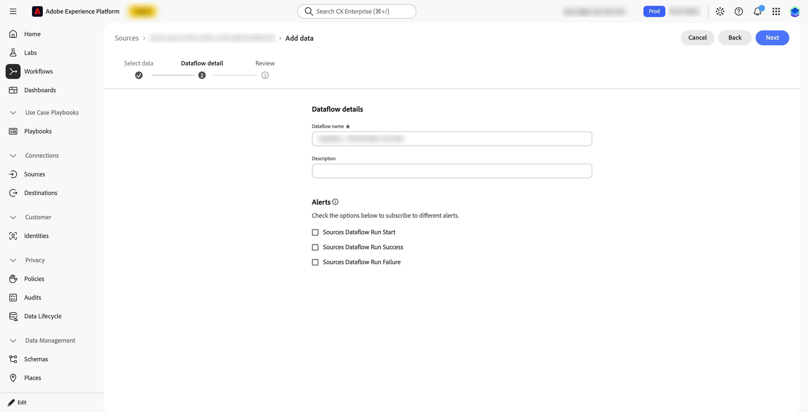
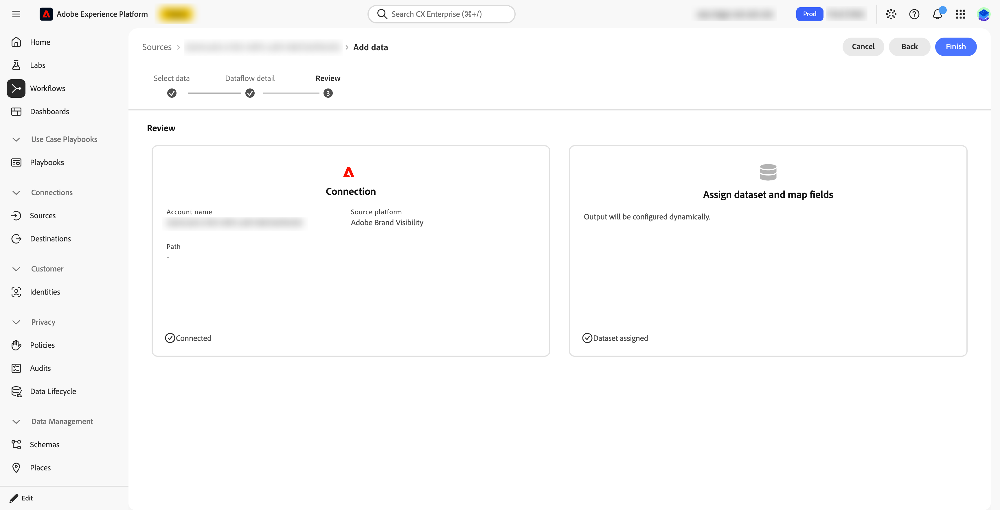

# Einrichten und Konfigurieren der eingehenden Integration

In diesem Artikel werden die [Voraussetzungen](#prerequisites), [Zuständigkeiten](#responsibilities), [Überprüfungsschritte](#verification), [Fehlerbehebungsschritte](#troubleshoot) und [Abschlusskriterien](#completion-criteria) für das Einrichten und Konfigurieren der eingehenden Markensichtbarkeit-Integration mit Customer Journey Analytics beschrieben.

## Voraussetzungen

Beachten Sie die folgenden Voraussetzungen, bevor Sie die eingehende Integration aktivieren. Verwenden Sie das [Überprüfungsverfahren](#verification) unten, um jede Voraussetzung zu bestätigen.

### BYOCDN-Protokollweiterleitung

CDN-Zugriffsprotokolle müssen für jede Markensichtbarkeit-Site an Adobe Brand Visibility weitergeleitet und von empfangen werden, bevor der Markensichtbarkeit-Quell-Connector funktionsfähig ist.

Diese Anforderung gilt für jede Markensichtbarkeit-Site. Eine CDN-Konfiguration oder ein Protokoll-Feed für eine Site, Domain oder Subdomain deckt nur diese Site ab.

Bestätigen Sie beide Teile der Übergabe:

1. Sie haben die entsprechende CDN- oder Protokoll-Pipeline konfiguriert, um die erforderlichen Zugriffsprotokolle an das von Adobe bereitgestellte Amazon S3-Ziel weiterzuleiten.
1. Markensichtbarkeit empfängt und erkennt die Protokolle für die jeweilige Website. Die Site kann dann in der Adobe Brand Visibility-Quelle in Experience Platform ausgewählt werden.

Die BYOCDN-Protokollweiterleitung stellt die Server-seitigen CDN-Anfragedaten bereit, die für die automatisierte Analyse von Agenten-Traffic verwendet werden. Die Daten hängen nicht von JavaScript-Tags ab, die in einem Browser ausgeführt werden. Die erforderlichen
CDN-Protokoll-Feed stellt sicher, dass der nachgelagerte Zusammenfassungsdatensatz die vorgesehenen Markensichtbarkeit-agenten-Traffic-Daten enthält. Weitere Informationen finden Sie [BYOCDN](https://experienceleague.adobe.com/en/docs/brand-visibility/using/log-forwarding/log-forwarding-overview)Protokollweiterleitungsreferenz).

### Erforderliche Informationen

Stellen Sie sicher, dass Sie für jede Markensichtbarkeit-Site Werte für alle erforderlichen Details in der folgenden Tabelle aufgeführt haben.

| Erforderlicher Wert | Bestätigung oder Hinweise |
|---|---|
| Markensichtbarkeit-Site oder -Domain | Bestätigen Sie, dass die Website von der CDN-Protokollweiterleitung abgedeckt wird. |
| CDN-Provider | Identifizieren Sie das CDN, das die Site bereitstellt. |
| CDN-Protokollweiterleitungsstatus | Nachweis, dass die Protokolle für die Website weitergeleitet und von der Markensichtbarkeit erkannt werden |
| Site in Markensichtbarkeit-Quelle verfügbar | Vergewissern Sie sich, dass die Site in der Markensichtbarkeit-Quelle zur Auswahl verfügbar ist. Abhängig von der Verfügbarkeit geparster CDN-Protokolle in Markensichtbarkeit ist eine Site verfügbar. |
| IMS-Organisation | Verwenden Sie die exakte IMS-Organisation, die mit Markensichtbarkeit, Experience Platform verknüpft ist. |
| Sandbox | Verwenden Sie den genauen Sandbox-Namen, der für die eingehende Integration angegeben ist. |
| Verbindung | Identifizieren Sie die Kunden-Journey-Verbindung, die den Datensatz enthalten soll. |
| Datenansicht | Identifizieren Sie eine neue oder vorhandene Customer Journey Analytics-Datenansicht, die die -Komponenten enthalten sollte. |
| Administrator oder Besitzer | Geben Sie den Namen oder das Team an, das der Konfigurationskontakt ist. |

Vergewissern Sie sich, dass jede Site in der Adobe Brand Visibility-Quelle verfügbar ist, bevor Sie fortfahren.

### Sandbox

Sie können den Datensatz zur CJA-Verbindung hinzufügen, nachdem der Datensatz in der Sandbox **[!UICONTROL Datensätze]** angezeigt wurde.

Bestätigen Sie Folgendes:

* IMS-Organisation
* Experience Platform-Sandbox von Target

Die Ziel-AEP-Sandbox ist dieselbe benannte Sandbox, die von der entsprechenden Customer Journey Analytics-Verbindung bzw. den Verbindungen verwendet wird, die den Datensatz enthalten.

Der Kunde kann den Datensatz erst dann zur entsprechenden CJA-Verbindung hinzufügen, wenn Adobe bestätigt hat, dass der verwaltete Datensatz erstellt wurde.

### Zusammenfassungsdatensatz

Die eingehende Integration bietet einen aggregierten Zusammenfassungsdatensatz in Experience Platform, der serverseitige CDN-Anfrageinformationen enthält, die mit LLM, Bot und Automated-Agent verknüpft sind
Traffic

Markensichtbarkeit verwendet CDN-Zugriffsprotokolle, um Anfragen von Bots und automatisierten Agenten zu identifizieren. Dieser Traffic löst keine Browser-JavaScript-Tags aus und wird daher nicht über eine herkömmliche Web-Analytics-Implementierung erfasst.

Eine ausführliche Beschreibung der eingehenden Integration, der Datensatzstruktur und der verfügbaren Felder finden Sie unter [Über den Datensatz](#about-the-dataset).

Die Markensichtbarkeit-Quelle erstellt den Zusammenfassungsdatensatz in Experience Platform mit:

* Die **[!UICONTROL XDM Summary Metrics]**-Klasse
* Die Feldergruppe **[!UICONTROL CDN-]**-Zusammenfassung“
* Felder, die unter einem (**[!UICONTROL )]** Objekt organisiert sind

Der Connector erstellt den Datensatz für jede Markensichtbarkeit-Site unter Verwendung des folgenden Benennungsmusters: <code>Adobe Brand Visibility (ABV)-Datensatz - _baseUrl ohne Schema_</code>.  Zum Beispiel `Adobe Brand Visibility (ABV) Dataset - example.com` für die Site-<https://example.com>.

Datensätze, die vor der Annahme dieser Namenskonvention erstellt wurden, zeigen das frühere Muster <code>LLM-Optimierungsdatensatz (LLMO) - _baseUrl ohne Schema_</code>.

Suchen Sie den Datensatz in **[!UICONTROL Datensätze]** in der Sandbox, in der Sie den Datenfluss erstellt haben.

Der Datensatz besteht aus aggregierten Zusammenfassungsdaten. Verwenden Sie beim Analysieren des Anfragevolumens in Customer Journey Analytics die bereitgestellte Metrik **[!UICONTROL CDN-Anfragenanzahl]** anstatt die Datensatzzeilen zu zählen.

Überprüfen Sie die verfügbaren Felder im Datensatzschema, das für die jeweilige Markensichtbarkeit-Site erstellt wurde. Um die Konfiguration der Datenansicht zu planen, überprüfen Sie die Felder.

## Zuständigkeiten

Nachdem Sie die Markensichtbarkeit-Quelle aktiviert haben, Markensichtbarkeit:

* Stellt den Zusammenfassungsdatensatz für die ausgewählte Site bereit.
* Lädt den Datensatz in die Sandbox, in der Sie den Datenfluss erstellt haben.

Ihre Aufgaben als Kunde sind:

* Um sicherzustellen, dass CDN-Protokolle an jede Markensichtbarkeit-Site weitergeleitet und von Markensichtbarkeit empfangen werden.
* Um die Markensichtbarkeit-Quelle in der richtigen Sandbox zu aktivieren, überprüfen Sie, ob Ihre Site zur Auswahl verfügbar ist, und wählen Sie sie aus.
* So wählen Sie die Customer Journey Analytics-Verbindung aus, die den Datensatz enthalten soll.
* So fügen Sie den Datensatz zu dieser Verbindung hinzu.
* So wählen Sie die Felder aus, die als Komponenten in der entsprechenden Customer Journey Analytics-Datenansicht verfügbar gemacht werden sollen.
* So überprüfen Sie, ob die resultierenden Dimensionen und Metriken die beabsichtigte Analyse unterstützen.

>[!IMPORTANT]
>
>Der verwaltete Connector wird absichtlich angehalten, nachdem der Experience Platform-Datensatz erstellt und ausgefüllt wurde. Adobe ändert Ihre Customer Journey Analytics-Verbindungen oder -Datenansichten nicht.

Der Datensatz steht erst dann für die Customer Journey Analytics-Analyse zur Verfügung, wenn Sie den Datensatz zu einer Verbindung hinzufügen. Die Daten
steht Benutzern erst dann über eine Datenansicht zur Verfügung, wenn die entsprechenden Felder zu dieser Datenansicht hinzugefügt wurden.

So aktivieren Sie die Quelle:

1. Wählen Sie in Experience Platform die Sandbox aus, in der der Datensatz gespeichert werden soll. Eine Site kann nur einmal zugewiesen werden. Stellen Sie daher sicher, dass diese Sandbox die gewünschte ist.
1. Gehen Sie zu **[!UICONTROL Quellen]**, dann **[!UICONTROL Katalog]**, dann zu Adobe-Anwendungen. Wählen Sie auf der Karte **&#x200B;**&#x200B;die Option **[!UICONTROL Einrichten]** beim ersten Mal aus. Danach zeigt die Karte **[!UICONTROL Daten hinzufügen]** an.

   

1. Wählen Sie **[!UICONTROL Daten hinzufügen]** aus.

   

1. Im ➊ Schritt **[!UICONTROL Auswählen von]**:

   1. Wählen Sie die Site aus der Tabelle **[!UICONTROL Site-Name]** aus. Nachdem eine Site einem Datenfluss zugewiesen wurde, können Sie die Site in dieser oder einer anderen Sandbox nicht mehr auswählen.

      

   1. Wählen Sie **[!UICONTROL Weiter]** aus.

1. Im ➋ Schritt **[!UICONTROL Datenflussdetails]**:

   1. Geben Sie einen **[!UICONTROL Datenflussnamen]** und optional eine **[!UICONTROL Beschreibung]** ein. Sie können auch die Warnhinweise **[!UICONTROL Start des Datenflusses im Quelldatenfluss]**, **[!UICONTROL Erfolg der Datenflussausführung im Quelldatenfluss]** und **[!UICONTROL Fehler bei der Datenflussausführung im)]**.

      

   1. Wählen Sie **[!UICONTROL Weiter]** aus.

1. Im ➌ Schritt **[!UICONTROL Überprüfen]**:

   1. Überprüfen Sie die Verbindung und die Datensatzzuweisung.

      

   1. Wählen Sie **[!UICONTROL Beenden]** aus.

Der Datensatz wird automatisch zugewiesen und es ist keine Feldzuordnung erforderlich.

>[!IMPORTANT]
>
>Eine Site kann nur einmal zugewiesen werden. Um die Site in einer anderen Sandbox zu verwenden, löschen Sie den Datenfluss, dem die Site zugewiesen ist. Das Löschen des Datenflusses wirkt sich auf alle Customer Journey Analytics-Verbindungen oder -Datenansichten aus, die auf die Daten aus dieser Quelle angewiesen sind.
>

## Verifizierung

Gehen Sie wie folgt vor, um die eingehende Integration zu überprüfen:

1. Bestätigen der Bereitschaft von ABV-Site und CDN-Protokoll.

   Für jede ABV-Website:

   * Bestätigen Sie die genaue Site oder Domain, die von der CDN-Protokollweiterleitung abgedeckt wird.
   * Vergewissern Sie sich, dass die Site in der Markensichtbarkeit-Quelle in Experience Platform zur Auswahl verfügbar ist. Abhängig von der Verfügbarkeit geparster CDN-Protokolle in Markensichtbarkeit ist eine Site verfügbar.
   * Fahren Sie nicht mit der allgemeinen Anweisung fort, dass „CDN-Protokolle aktiviert sind“. Fahren Sie fort, wenn die spezifische ABV-Site zur Auswahl verfügbar ist.
   * Vergewissern Sie sich, dass der Markensichtbarkeit Protokolle für diese Website empfängt oder erkennt.
   * Erhalten Sie von Adobe die Markensichtbarkeit-Bereitschaftsbestätigung der Site.

1. Überprüfen Sie den Datensatz in Experience Platform.

   Nachdem Sie den Datenfluss erstellt haben:
   1. Bei **[!UICONTROL Experience Platform anmelden]**.
   1. Wählen Sie die Sandbox aus, in der Sie den Datenfluss erstellt haben.
   1. Suchen Sie den Datensatz für Ihre Markensichtbarkeit-Site in **[!UICONTROL Datensätze]**.
   1. Vergewissern Sie sich, dass der Datensatz mit der erwarteten Markensichtbarkeit-Site verknüpft ist.
   1. Zeichnen Sie die **[!UICONTROL Datensatz-ID]** und das verknüpfte **[!UICONTROL Schema]** auf.
   1. Überprüfen Sie die Anzahl der Datensätze, die neuesten Aufnahmeinformationen und verfügbare Beispieldaten, sofern zulässig.
   1. Öffnen Sie das verknüpfte Schema und überprüfen Sie die erwartete XDM-Struktur:
      * Klasse: **[!UICONTROL XDM Summary Metrics]**
      * Feldergruppe: **[!UICONTROL CDN-Anfragen - Zusammenfassung]**
      * Objekt: **[!UICONTROL cdn]**
      * Erwartete Dimensionen und Metriken, z **[!UICONTROL B. &quot;]**&quot;, **[!UICONTROL cdnProvider]**, **[!UICONTROL url]**, **[!UICONTROL host]**, **[!UICONTROL status]**, **[!UICONTROL requests]** und **[!UICONTROL timeToFirstByte]**.

1. Hinzufügen des Datensatzes zu einer Verbindung

   Ihr Customer Journey Analytics-Administrator muss den Datensatz zur gewünschten Verbindung hinzufügen:

   1. Melden Sie sich bei Customer Journey Analytics an.
   1. [Erstellen Sie eine neue Verbindung oder bearbeiten Sie die vorgesehene vorhandene Verbindung](/help/connections/create-connection.md). Vergewissern Sie sich, dass die Verbindung dieselbe Experience Platform-Sandbox verwendet, in der der Datensatz erstellt wurde.
   1. Suchen Sie nach dem Datensatz anhand des Namens oder der Datensatz-ID.
   1. Fügen Sie den Datensatz zur Verbindung hinzu.
   1. Konfigurieren Sie die Datensatzeinstellungen entsprechend dem Customer Journey Analytics-Design des Kunden.
   1. Speichern Sie die Verbindung.
   1. Um sicherzustellen, dass der Datensatz enthalten ist und die Aufnahme fortschreitet, überprüfen Sie die Verbindungsdetails.

1. Datenansicht konfigurieren oder aktualisieren

   Nachdem der Datensatz Teil der Verbindung ist:
   1. Melden Sie sich bei Customer Journey Analytics an.
   1. [Erstellen Sie eine neue Datenansicht oder bearbeiten Sie die Datenansicht](/help/data-views/create-dataview.md) die mit dem vorgesehenen Reporting-Anwendungsfall verknüpft ist.
   1. Wählen Sie die Verbindung aus, die den verwalteten Markensichtbarkeit-Datensatz enthält.
   1. Hinzufügen der erforderlichen Schemafelder als Dimensionen oder Metriken.
   1. Schließen Sie die für die geplante Analyse erforderlichen Felder ein, z. B.:
      * **[!UICONTROL CDN-Bot-Typ]**
      * **[!UICONTROL CDN-Anbieter]**
      * **[!UICONTROL CDN-URL]**
      * **[!UICONTROL CDN-Host]**
      * **[!UICONTROL CDN-HTTP-Status]**
      * **[!UICONTROL CDN-Anfragenanzahl]**
      * **[!UICONTROL CDN: Durchschn. Zeit bis zum ersten Byte]**
   1. Speichern Sie die Datenansicht.
   1. Validieren Sie die Felder in Analysis Workspace oder im vom Kunden ausgewählten Reporting-Workflow.

1. Validieren des End-to-End-Ergebnisses

   Verwenden Sie einen aktuellen Berichtszeitraum und überprüfen Sie, ob:

   * Die erwartete Markensichtbarkeit-Site wird angezeigt.
   * Die erwarteten CDN-Provider- und Host-Werte sind vorhanden.
   * Traffic von Bots oder automatisierten Agenten wird dargestellt.
   * URL- und HTTP-Status-Dimensionen enthalten erwartete Werte.
   * Die CDN-Anfragenanzahl und -Leistungsmetriken sind verfügbar.
   * Der Datensatz ist in der beabsichtigten Verbindung enthalten.
   * Die erforderlichen Felder werden in der vorgesehenen Datenansicht verfügbar gemacht.

Der genaue Zeitraum, der erforderlich ist, damit Daten verfügbar werden, hängt vom Aufnahme- und Customer Journey Analytics-Verarbeitungs-Workflow ab.

## Fehlerbehebung

Wenn Probleme auftreten, führen Sie folgende Schritte durch:

* Der Datensatz wird nicht in AEP angezeigt.

  Überprüfen Sie, ob:

  * Die IMS-Organisation ist korrekt.
  * Die ausgewählte Experience Platform-Sandbox ist korrekt.
  * Die Quelle wurde aktiviert, nachdem die CDN-Protokollweiterleitung funktioniert hatte.
  * Der von Adobe bereitgestellte Datensatzname oder die ID wurde verwendet.
  * Der Datensatz wurde für die richtige Markensichtbarkeit-Site erstellt.

* Der Datensatz existiert, enthält aber keine erwarteten Daten.

  Überprüfen Sie, ob:
  * CDN-Protokolle werden an die exakte Markensichtbarkeit-Site weitergeleitet.
  * Markensichtbarkeit empfängt oder erkennt Protokolle für die Site.
  * Die Site oder Domain in der CDN-Konfiguration stimmt mit der Markensichtbarkeit-Site überein.
  * Der verwaltete Connector wurde aktiviert, nachdem die CDN-Protokollbereitschaft bestätigt wurde.
  * Der ausgewählte Datumsbereich umfasst den Zeitraum nach Beginn der Protokollaufnahme.

* Der Datensatz existiert in Experience Platform, ist aber in Customer Journey Analytics nicht verfügbar.

  Überprüfen Sie, ob:
  * Die Customer Journey Analytics-Verbindung verwendet dieselbe benannte Experience Platform-Sandbox.
  * Der Datensatz wurde der Verbindung explizit hinzugefügt.
  * Der Customer Journey Analytics-Administrator verfügt über die erforderlichen Berechtigungen.
  * Die Verbindung wurde gespeichert, nachdem der Datensatz hinzugefügt wurde.

* Der Datensatz befindet sich in der Verbindung, Felder sind jedoch nicht für das Reporting verfügbar.

  Überprüfen Sie, ob:
  * Die Datenansicht wählt die richtige Customer Journey Analytics-Verbindung aus.
  * Die erwarteten Schemafelder wurden als Datenansichtskomponenten hinzugefügt.
  * Die Felder wurden im vorgesehenen Abschnitt **[!UICONTROL Dimensionen]** oder **[!UICONTROL Metriken)]**.
  * Die Datenansicht wurde gespeichert, nachdem die Komponenten hinzugefügt wurden.
  * Das Datensatzschema entspricht der erwarteten Feldergruppenstruktur **[!UICONTROL CDN-]**-Zusammenfassung).

* Die Website ist nicht in der Liste enthalten.

  Überprüfen Sie, ob:

  * Es ist eine Site verfügbar, die basierend auf der Verfügbarkeit geparster CDN-Protokolle in Markensichtbarkeit ausgewählt werden kann.
  * Die CDN-Protokollweiterleitung ist eingerichtet und funktioniert für die Site.

* Die Website kann nicht ausgewählt werden.

  Beachten Sie, dass eine Site, sobald sie einem Datenfluss zugewiesen wurde, in dieser oder einer anderen Sandbox nicht mehr ausgewählt werden kann. Um die Site in einer anderen Sandbox zu verwenden, löschen Sie den Datenfluss, dem die Site zugewiesen ist. Die Site kann dann erneut ausgewählt werden. Das Löschen des Datenflusses wirkt sich auf alle Customer Journey Analytics-Verbindungen oder -Datenansichten aus, die auf die Daten aus dieser Quelle angewiesen sind.

* Der Datenfluss zeigt den Status Fehlgeschlagen an.

  Verwenden Sie das **[!UICONTROL Monitoring]**-Dashboard. In der Übersicht **[!UICONTROL Quellen]** wird darauf hingewiesen, dass ein Quelldatenfluss, der 30 Tage lang kontinuierlich fehlschlägt, automatisch deaktiviert wird.

## Abschlusskriterien

Die eingehende Integration ist für die kundenseitige Customer Journey Analytics-Konfiguration bereit, wenn alles Folgende bestätigt wird:

* CDN-Protokolle werden für jede angeforderte ABV-Site an Markensichtbarkeit weitergeleitet und von dieser empfangen.
* Jede Markensichtbarkeit-Site steht in der Adobe Brand Visibility-Quelle zur Auswahl.
* Sie haben die Adobe Brand Visibility-Quelle in der vorgesehenen Sandbox aktiviert.
* Der Datensatz mit der Zusammenfassung pro Site wird in dieser Sandbox angezeigt.
* Sie haben den Datensatz und sein XDM-Schema überprüft.
* Sie haben den Datensatz zur gewünschten CJA-Verbindung hinzugefügt.
* Sie haben die entsprechenden CJA-Datenansichtskomponenten konfiguriert.

