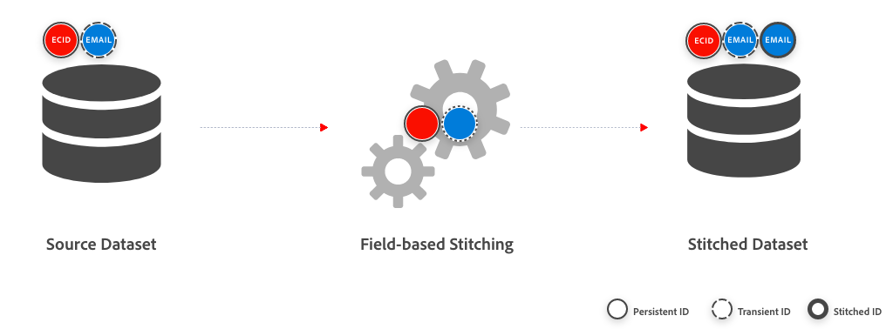

# Feldbasierte Zuordnung

Bei der feldbasierten Zuordnung geben Sie einen Ereignis-Datensatz sowie die persistente ID (Cookie) und Personen-ID für diesen Datensatz an. Bei der feldbasierten Zuordnung wird versucht, die Personen-ID-Informationen für die Customer Journey Analytics-Datenanalyse bei allen anonymen Ereignissen mit einer bestimmten persistenten ID verfügbar zu machen.  Diese Informationen werden aus den Zeilen abgerufen, die eine Personen-ID für diese bestimmte persistente ID haben.

Wenn die Personen-ID-Informationen für ein Ereignis nicht abgerufen werden können, wird stattdessen die persistente ID für dieses (nicht *)* verwendet. Daher enthält in einer [Datenansicht](/help/data-views/data-views.md) die mit einer [Verbindung“ verknüpft ist, ](/help/connections/overview.md) den Datensatz enthält, der für das Zusammenfügen aktiviert ist, die Personen-ID-Komponente entweder den Personen-ID-Wert oder den beständigen ID-Wert auf der Ereignisebene.

Sie können das feldbasierte Stitching verwenden, wenn Sie Customer Journey Analytics als eigenständige Lösung verwenden (ohne Zugriff auf den Experience Platform Identity Service und das zugehörige Identitätsdiagramm). Oder wenn Sie den verfügbaren Identitätsdiagramm nicht verwenden möchten.

## IdentityMap

Die feldbasierte Zuordnung unterstützt die Verwendung der [`identityMap`-Feldergruppe](https://experienceleague.adobe.com/de/docs/experience-platform/xdm/schema/composition#identity) in folgenden Szenarien:

- Verwendung der primären Identität in `identityMap`-Namespaces zur Definition der persistenten ID:
  - Wenn mehrere primäre Identitäten in verschiedenen Namespaces gefunden werden, werden die Identitäten in den Namespaces lexikografisch sortiert, und die erste Identität wird ausgewählt.
  - Wenn mehrere primäre Identitäten in einem einzigen Namespace gefunden werden, wird die lexikografisch erste primäre Identität ausgewählt, die verfügbar ist.

  Im folgenden Beispiel führen die Namespaces und Identitäten zu einer sortierten primären Identitätsliste und schließlich zur ausgewählten Identität.

  <table style="table-layout:auto">
     <tr>
       <th>Namespaces</th>
       <th>Liste der Identitäten</th>
     </tr>
     <tr>
       <td>ECID</td>
       <td><pre lang="json"><code>[ &nbsp;&nbsp;{"id": "ecid-3"}, &nbsp;&nbsp;{"id": "ecid-2", "primary": true}, &nbsp;&nbsp;{"id": "ecid-1", "primary": true} &nbsp;]</code></pre></td>
     </tr>
     <tr>
       <td>CCID</td>
       <td><pre lang="json"><code>[ &nbsp;&nbsp;{"id": "ccid-1"}, &nbsp;&nbsp;{"id": "ccid-2", "primary": true} ]</code></pre></td>
     </tr>
   </table>

  <table style="table-layout:auto">
    <tr>
      <th>Sortierte Identitätsliste</th>
      <th>Ausgewählte Identität</th>
    </tr>
    <tr>
      <td><pre lang="json"><code>PrimaryIdentities [ &nbsp;&nbsp;{"id": "ccid-2", "namespace": "CCID"}, &nbsp;&nbsp;{"id": "ecid-1", "namespace": "ECID"}, &nbsp;&nbsp;{"id": "ecid-2", "namespace": "ECID"} ] NonPrimaryIdentities [ &nbsp;&nbsp;{"id": "ccid-1", "namespace": "CCID"}, &nbsp;&nbsp;{"id": "ecid-3", "namespace": "ECID"} ]</code></pre></td>
      <td><pre lang="json"><code>"id": "ccid-2", "namespace": "CCID"</code></pre></td>
    </tr>
  </table>

- Verwendung des `identityMap`-Namespace zum Definieren der persistenten ID, der Personen-ID oder beider:
  - Wenn in einem `identityMap`-Namespace mehrere Werte für eine persistente ID oder Personen-ID gefunden werden, wird der lexikografisch erste verfügbare Wert verwendet.
  - Namespaces für persistente ID und Personen-ID müssen sich gegenseitig ausschließen.

  Im folgenden Beispiel haben Sie „ECID“ als zu verwendenden Namespace ausgewählt. Diese Auswahl führt zu einer sortierten Identitätsliste und schließlich zur ausgewählten Identität.

  <table style="table-layout:auto">
     <tr>
       <th>Namespaces</th>
       <th>Liste der Identitäten</th>
     </tr>
     <tr>
       <td>ECID</td>
       <td><pre lang="json"><code>[ &nbsp;&nbsp;{"id": "ecid-3"}, &nbsp;&nbsp;{"id": "ecid-2", "primary": true}, &nbsp;&nbsp;{"id": "ecid-1", "primary": true} ]</code></pre></td>
     </tr>
     <tr>
       <td>CCID</td>
       <td><pre lang="json"><code>[ &nbsp;&nbsp;{"id": "ccid-1"}, &nbsp;&nbsp;{"id": "ccid-2", "primary": true} ]</code></pre></td>
     </tr>
   </table>

  <table style="table-layout:auto">
    <tr>
      <th>Sortierte Identitätsliste</th>
      <th>Ausgewählte Identität</th>
    </tr>
    <tr>
      <td><pre lang="json"><code>[ &nbsp;&nbsp;"id": "ecid-1", &nbsp;&nbsp;"id": "ecid-2", &nbsp;&nbsp;"id": "ecid-3" ]</code></pre></td>
      <td><pre lang="json"><code>"id": "ecid-1", "namespace": "ECID"</code></pre></td>
    </tr>
  </table>

## Funktionsweise der Zuordnung

Beim Stitching werden in einem bestimmten Datensatz mindestens zwei Durchläufe über die Daten durchgeführt.

- **Live-Zuordnung:**: Versucht, bei Eingang jeden Treffer (Ereignis) zuzuordnen. Treffer von Geräten, die *neu* im Datensatz sind (sich noch nie authentifiziert haben), werden in der Regel nicht auf dieser Ebene zugeordnet. Treffer von bereits erkannten Geräten werden sofort gestitcht.

- **Wiederholte Zuordnung:** *Wiederholt* Daten basierend auf eindeutigen Kennungen (Personen-IDs). In diesem Schritt werden Treffer von zuvor unbekannten Geräten (persistente IDs) zugeordnet (zu Personen-IDs). Zwei Parameter bestimmen die Wiederholung: **Häufigkeit** und **Lookback-Fenster**. Adobe bietet die folgenden Kombinationen dieser Parameter:
  - **Täglicher Lookback mit täglicher Häufigkeit:** Daten werden täglich mit einem 24-Stunden-Lookback-Fenster wiederholt. Diese Option bietet den Vorteil, dass Wiederholungen viel häufiger vorkommen. Nicht authentifizierte Profile müssen sich jedoch an demselben Tag authentifizieren, an dem sie Ihre Website besuchen.
  - **Wöchentlicher Lookback in wöchentlicher Häufigkeit:** Die Daten werden einmal wöchentlich mit einem wöchentlichen Lookback-Fenster wiederholt (siehe [Optionen](overview.md#options)). Diese Option hat den Vorteil, dass nicht authentifizierte Sitzungen deutlich mehr Zeit für die Authentifizierung haben. Nicht zugeordnete Daten, die weniger als eine Woche alt sind, werden jedoch erst bei der nächsten wöchentlichen Wiederholung erneut verarbeitet.
  - **Vierzehntägiger Lookback mit wöchentlicher Häufigkeit:** Die Daten werden einmal wöchentlich mit einem zweiwöchentlichen Lookback-Fenster wiederholt (siehe [Optionen](overview.md#)). Diese Option hat den Vorteil, dass nicht authentifizierte Sitzungen deutlich mehr Zeit für die Authentifizierung haben. Nicht zugeordnete Daten, die weniger als zwei Wochen alt sind, werden jedoch erst bei der nächsten wöchentlichen Wiederholung erneut verarbeitet.
  - **Monatlicher Lookback mit wöchentlicher Häufigkeit:** Daten werden wöchentlich mit einem monatlichen Lookback-Fenster wiederholt (siehe [Optionen](overview.md#options)). Diese Option hat den Vorteil, dass nicht authentifizierte Sitzungen deutlich mehr Zeit für die Authentifizierung haben. Nicht zugeordnete Daten, die weniger als einen Monat alt sind, werden jedoch erst bei der nächsten wöchentlichen Wiederholung erneut verarbeitet.

- **Datenschutz**: Wenn datenschutzbezogene Anfragen empfangen werden, muss neben dem Entfernen der angeforderten Identität auch jede Zuordnung dieser Identität zu nicht authentifizierten Ereignissen rückgängig gemacht werden.

  >[!IMPORTANT]
  >
  >Das Verfahren zur Aufhebung der Zuordnung im Rahmen von Datenschutzanfragen ändert sich Anfang 2025. Das aktuelle Verfahren ordnet Ereignisse anhand der neuesten Version bekannter Identitäten neu zu. Diese Neuzuweisung von Ereignissen an eine andere Identität kann unerwünschte rechtliche Folgen haben. Um diesen Bedenken zu begegnen, werden Ereignisse, die Gegenstand der Datenschutzanfrage sind, ab 2025 durch das neue Verfahren zur Aufhebung der Zuordnung mit der persistenten ID aktualisiert.
  > 

Daten, die über das Lookback-Fenster hinausgehen, werden nicht erneut verarbeitet. Ein Profil muss innerhalb eines gegebenen Lookback-Fensters authentifiziert werden, damit ein nicht authentifizierter Besuch und ein authentifizierter Besuch gemeinsam identifiziert werden können. Sobald ein Gerät erkannt wurde, wird dieses Gerät von diesem Punkt an live zugeordnet.

### Schritt 1: Live-Zuordnung

Die Live-Zuordnung versucht bei der Erfassung, jedes Ereignis bekannten Geräten und Kanälen zuzuordnen.

+++ Details

Betrachten Sie das folgende Beispiel, bei dem Bob verschiedene Ereignisse als Teil eines Ereignisdatensatzes aufzeichnet.

*Daten, wie sie am Tag der Erfassung auftraten:*

| Ereignis | Zeitstempel | Persistente ID (Cookie-ID) | Personen-ID | Resultierende ID (nach der Echtzeit-Zuordnung) |
|---|---|---|---|---|
| 1 | 2023-05-12 12:01 | `246`  | – | **`246`** |
| 2 | 2023-05-12 12:02 | `246` | `Bob`  | `Bob` |
| 3 | 2023-05-12 12:03 | `246` | `Bob`  | `Bob`  |
| 4 | 2023-05-12 12:04 | `246` | – | **`Bob`** |
| 5 | 2023-05-12 12:05 | `246` | `Bob`  | `Bob`  |
| 6 | 2023-05-12 12:06 | `246` | – | **`Bob`** |
| 7 | 2023-05-12 12:07 | `246` | `Bob`  | `Bob` |
| 8 | 2023-05-12 12:03 | `3579`  | – | **`3579`** |
| 9 | 2023-05-12 12:09 | `3579`  | – | **`3579`** |
| 10 | 2023-05-12 12:02 | `81911`  | – | **`81911`** |
| 11 | 2023-05-12 12:05 | `81911` | `Bob`  | `Bob`  |
| 12 | 2023-05-12 12:12 | `81911` | – | **`Bob`** |
| | | **3 Geräte** | | **4 Personen:** `246`, `Bob`, `3579`, `81911` |

Sowohl nicht authentifizierte als auch authentifizierte Ereignisse auf neuen Geräten werden (vorübergehend) als separate Personen gezählt. Nicht authentifizierte Ereignisse auf erkannten Geräten werden live zusammengeführt.

Die Attribution funktioniert, wenn die Identifizierung der benutzerdefinierten Variablen an ein Gerät gebunden ist. Im obigen Beispiel werden alle Ereignisse mit Ausnahme der Ereignisse 1, 8, 9 und 10 live zugeordnet (sie verwenden alle die Kennung `Bob`). Die Live-Zuordnung „löst“ die resultierende ID für Ereignis 4, 6 und 12 auf.

Verzögerte Daten (Daten mit einem Zeitstempel, der mehr als 24 Stunden zurückliegt) werden nach dem Prinzip der „bestmöglichen Verarbeitung“ behandelt, wobei die Zusammenführung aktueller Daten für eine möglichst hohe Qualität priorisiert wird.

+++ 

### Schritt 2: Wiederholte Zuordnung

In regelmäßigen Abständen (einmal pro Woche oder einmal pro Tag, je nach ausgewähltem Lookback-Fenster) berechnet das Replay-Stitching historische Daten erneut auf der Grundlage von Geräten, die jetzt erkannt werden. Wenn ein Gerät zunächst Daten sendet, während es nicht authentifiziert ist, und sich dann anmeldet, verknüpft das Replay-Stitching diese nicht authentifizierten Ereignisse mit der richtigen Person.

+++ Details

Die folgende Tabelle stellt dieselben Daten wie oben dar, zeigt jedoch unterschiedliche Zahlen basierend auf der erneuten Verarbeitung der Daten.

*Dieselben Daten nach der Wiederholung:*

| Ereignis | Zeitstempel | Persistente ID (Cookie-ID) | Personen-ID | Resultierende ID (nach der Echtzeit-Zuordnung) | Resultierende ID (nach der Wiederholung) |
|---|---|---|---|---|---|
| 1 | 2023-05-12 12:01 | `246` | – | `246` | **`Bob`** |
| 2 | 2023-05-12 12:02 | `246` | `Bob`  | `Bob` | `Bob`  |
| 3 | 2023-05-12 12:03 | `246` | `Bob`  | `Bob` | Bob |
| 4 | 2023-05-12 12:04 | `246` | – | **`Bob`** | `Bob` |
| 5 | 2023-05-12 12:05 | `246` | `Bob`  | `Bob`  | `Bob` |
| 6 | 2023-05-12 12:06 | `246` | – | **`Bob`** | `Bob` |
| 7 | 2023-05-12 12:07 | `246` | `Bob`  | `Bob` | `Bob` |
| 8 | 2023-05-12 12:03 | `3579`  | – | **`3579`** | **`3579`** |
| 9 | 2023-05-12 12:09 | `3579`  | – | **`3579`** | **`3579`** |
| 10 | 2023-05-12 12:02 | `81911` | – | `81911` | **`Bob`** |
| 11 | 2023-05-12 12:05 | `81911` | `Bob`  | `Bob`  | `Bob`  |
| 12 | 2023-05-12 12:12 | `81911` | – | **`Bob`** | `Bob` |
| | | **3 Geräte** | | **4 Personen:** `246`, `Bob`, `3579`, `81911` | **2 Personen:**: `Bob`, `3579` |

{style="table-layout:auto"}

Die Attribution funktioniert, wenn die Identifizierung der benutzerdefinierten Variablen an ein Gerät gebunden ist. Im obigen Beispiel werden Ereignis 1 und 10 durch das Replay zusammengeführt, sodass nur Ereignis 8 und 9 nicht zusammengeführt sind. und die Metrik für Personen (kumulativ) auf 2 reduziert wird.

+++ 

### Schritt 3: Datenschutzanfrage

Wenn Sie eine Datenschutzanfrage erhalten, werden alle Kennungsinformationen, die vom Zuordnungsprozess zum Wert der Personen-ID festgelegt wurden, in allen Datensätzen zu einem persistenten ID-Wert für den Benutzer bzw. die Benutzerin, der bzw. die Gegenstand der Datenschutzanfrage ist, aktualisiert.

+++ Details

Die folgende Tabelle stellt dieselben Daten wie oben dar, zeigt jedoch die Auswirkungen, die eine Datenschutzanfrage für Bob nach der Verarbeitung auf die Daten hat. Die Zeilen, in denen Bob authentifiziert ist, werden entfernt (2, 3, 5, 7 und 11), außerdem wird Bob als Personen-ID für andere Zeilen entfernt.

*Dieselben Daten nach einer Datenschutzanfrage für Bob:*

| Ereignis | Zeitstempel | Persistente ID (Cookie-ID) | Personen-ID | Resultierende ID (nach der Echtzeit-Zuordnung) | Resultierende ID (nach der Wiederholung) | Personen-ID | Ergebnis-ID (nach Datenschutzanfrage) |
|---|---|---|---|---|---|---|---|
| 1 | 2023-05-12 12:01 | `246` | – | `246` | **`Bob`** | – | `246` |
| 2 | 2023-05-12 12:02 | `246` | Bob  | `Bob` | `Bob`  |  | `246` |
| 3 | 2023-05-12 12:03 | `246` | Bob  | `Bob`  | `Bob` |  | `246` |
| 4 | 2023-05-12 12:04 | `246` | – | **`Bob`** | `Bob` | – | `246` |
| 5 | 2023-05-12 12:05 | `246` | Bob  | `Bob`  | `Bob` |  | `246` |
| 6 | 2023-05-12 12:06 | `246` | – | **`Bob`** | `Bob` | – | `246` |
| 7 | 2023-05-12 12:07 | `246` | `Bob`  | `Bob` | `Bob` |  | `246` |
| 8 | 2023-05-12 12:03 | `3579`  | – | **`3579`** | **`3579`** | – | `3579` |
| 9 | 2023-05-12 12:09 | `3579`  | – | **`3579`** | **`3579`** | – | `3579` |
| 10 | 2023-05-12 12:02 | `81911` | – | `81911` | **`Bob`** | – | `81911` |
| 11 | 2023-05-12 12:05 | `81911` | `Bob`  | `Bob`  | `Bob`  |  | `81911` |
| 12 | 2023-05-12 12:12 | `81911` | – | **`Bob`** | `Bob` | – | `81911` |
| | | **3 Geräte** | | **4 Personen:** 246, `Bob`, `3579`, `81911` | **2 Personen:** Bob, `3579` |  | **3 Personen:** `246`, `3579`, `81911` |

+++ 

## Voraussetzungen

Die folgenden Voraussetzungen gelten speziell für feldbasiertes Stitching:

- Der Ereignis-Datensatz in Adobe Experience Platform, auf den Sie Stitching anwenden möchten, muss zwei Spalten aufweisen, die zur Identifizierung von Profilen dienen:

  - Eine **persistente ID**, eine Kennung, die in jeder Zeile vorhanden ist. Beispielsweise eine Besucher-ID, die von einer Adobe Analytics AppMeasurement-Bibliothek generiert wurde, oder eine von Edge Network generierte ECID.
  - Eine **Personen-ID**, eine Kennung, die nur in einigen Zeilen vorhanden ist. Beispielsweise ein gehashter Benutzername oder eine gehashte E-Mail-Adresse, wenn sich ein Profil authentifiziert. Sie können praktisch jede gewünschte Kennung verwenden. Beim Stitching wird davon ausgegangen, dass dieses Feld die tatsächlichen Informationen zur Personen-ID enthält. Um die besten Ergebnisse beim Zuordnen zu erzielen, sollte innerhalb der Ereignisse des Datensatzes für jede persistente ID mindestens einmal eine Personen-ID gesendet werden. Wenn Sie diesen Datensatz in eine Customer Journey Analytics-Verbindung einbeziehen möchten, sollten die anderen Datensätze ebenfalls eine ähnliche gemeinsame Kennung aufweisen.

<!--
- Both columns (persistent ID and person ID) must be defined as an identity field with an identity namespace in the schema for the dataset you want to stitch. When using identity stitching in Real-time Customer Data Platform, using the [`identityMap` field group](https://experienceleague.adobe.com/en/docs/experience-platform/xdm/schema/composition#identity), you still need to add identity fields with an identity namespace. This identification of identity fields is required as Customer Journey Analytics stitching does not support the `identityMap` field group. When adding an identity field in the schema, while also using the `identityMap` field group, do not set the additional identity field as a primary identity. Setting an additional identity field as primary identity interferes with the `identityMap` field group used for Real-time Customer Data Platform.

-->

## Einschränkungen

Die folgenden Einschränkungen gelten speziell für feldbasiertes Stitching:

- Die aktuellen Funktionen zur Neuzuweisung sind auf einen Schritt beschränkt (persistente ID zu Personen-ID). Eine mehrstufige Rekeying-Operation wird nicht unterstützt, beispielsweise von einer persistenten ID zu einer Personen-ID und anschließend zu einer weiteren Personen-ID.
- Wenn mehrere Personen ein Gerät gemeinsam nutzen und die Gesamtzahl der Transitionen zwischen den Benutzern 50.000 überschreitet, stoppt Customer Journey Analytics das Zusammenfügen von Daten für dieses Gerät.
- Benutzerdefinierte ID-Maps, die in Ihrem Unternehmen verwendet werden, werden nicht unterstützt.
- Bei der Zuordnung ist die Groß-/Kleinschreibung zu beachten. Für Datensätze, die über den Analytics-Quell-Connector generiert werden, empfiehlt Adobe die Prüfung aller VISTA-Regeln oder Verarbeitungsregeln, die für das Personen-ID-Feld gelten. Mit dieser Prüfung wird sichergestellt, dass keine dieser Regeln neue Formen derselben ID einführt. So sollten Sie beispielsweise sicherstellen, dass keine VISTA- oder Verarbeitungsregeln dafür sorgen, dass im Feld für die Personen-ID nur für einen Teil der Ereignisse Kleinschreibung verwendet wird.
- Beim Stitching werden Felder nicht kombiniert oder verkettet.
- Das Feld für die Personen-ID sollte nur einen ID-Typ enthalten (IDs aus einem einzigen Namespace). Das Feld für die Personen-ID sollte beispielsweise keine Kombination aus Anmelde-IDs und E-Mail-IDs enthalten.
- Wenn mehrere Ereignisse mit demselben Zeitstempel für dieselbe persistente ID auftreten, jedoch unterschiedliche Werte im Feld für die Personen-ID vorliegen, wird bei der Zuordnung die ID nach alphabetischer Reihenfolge ausgewählt. Wenn also eine persistente ID A zwei Ereignisse mit demselben Zeitstempel hat und eines der Ereignisse „Bob“ und das andere „Ann“ angibt, wählt das Stitching „Ann“ aus.
- Seien Sie vorsichtig bei Szenarien, in denen die Personen-IDs Platzhalterwerte enthalten, z. B. `Undefined`. Weitere Informationen finden Sie unter [Häufig gestellte Fragen](faq.md).
- Sie können nicht denselben Namespace sowohl für die persistente ID als auch für die Personen-ID verwenden. Die Namespaces müssen sich gegenseitig ausschließen.
